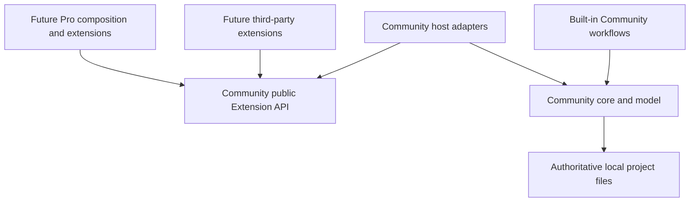

# Community extension architecture

**Classification: CORE.** Design for [#57](https://github.com/DarrenPratt/Drelwick/issues/57),
reviewed against Community main `354ae60` on 28 September 2026. This document
defines the future public boundary; it does **not** announce an available SDK,
plugin loader, sandbox or AI integration. Contract names and signatures below
are design notation, not importable TypeScript exports. Implementation must
prove the enforcement and compatibility requirements before advertising support.

## Decision and ownership

Community owns one capability-oriented Extension API. Optional Pro and future
third-party implementations consume the same contracts. Security policy can
restrict a contribution without creating separate Pro and plugin APIs.



Arrows represent dependencies/use, not grants of authority. `Pro -> Community`
is allowed; `Community -> Pro` is forbidden, including types, optional/peer/dev
dependencies, tests and build tooling. Community's default composition contains
only built-ins and an empty optional contribution set. A future separately
composed Pro distribution supplies implementations to a Community-owned host;
Community never imports Pro to register them. The Community host validates every
registration and operation regardless of the caller's publisher.

Keep basic DOCX import/export, EPUB, basic PDF, built-in themes, validation and
local backup/restore available without any plugin runtime, Pro package, account,
network or Drelwick backend. Built-ins may share conceptual contracts when useful;
do not move working features into dynamically loaded plugins. Planned Community
exporters must ship independently of this design's runtime follow-ups.

### SDK packaging decision

Defer `packages/plugin-sdk` until the first reviewed host implementation. There
is no executable consumer today, no general extension transport, and no DOCX
export implementation against which to stabilize an exporter type. The importer
and theme interfaces are intentionally internal and narrower than a public SDK.
Publishing placeholder types now would imply unsupported runtime guarantees or
freeze speculative structures. No alternate package name solves that problem.

The eventual `@drelwick/plugin-sdk` is a **Community** package containing only
versioned DTOs, contribution contracts and small boundary-validation helpers.
It must be usable without Electron, React, TipTap, Node globals or a core runtime.
Prefer dependency-free DTOs; reuse narrow renderer-safe Community types only
after reviewing their public compatibility. Do not re-export all of shared,
project-model or core: shared includes the desktop API, and core includes
privileged filesystem services. Project schemas remain owned by project-model;
host adapters translate them into the negotiated public DTO version.

The SDK must not import desktop, core, renderer implementations, Pro or private
source paths. Core/model/shared must not depend on the SDK to operate. Host
adapters can depend on both the SDK and existing Community services. Future
package creation requires a Community inventory entry, explicit package exports,
strict ESM TypeScript, `workspace:*` local dependencies, a separate consumer type
test and the existing #55 architecture checks. No package graph changes in #57.

### Evidence and readiness

[#55](https://github.com/DarrenPratt/Drelwick/issues/55) is closed and
[PR #196](https://github.com/DarrenPratt/Drelwick/pull/196) is merged at the audited
baseline. The PR originally recorded #52 as unresolved; live #55 closure does
not mean #52's broader product review or #53's legal review is complete.
[#109](https://github.com/DarrenPratt/Drelwick/issues/109) and merged
[PR #140](https://github.com/DarrenPratt/Drelwick/pull/140) establish the local
Community publishing requirements, not implemented exporters.

| Area              | Repository evidence at the baseline                                                                                                                                                                                                                                                     | Consequence for the public design                                                                                                                               |
| ----------------- | --------------------------------------------------------------------------------------------------------------------------------------------------------------------------------------------------------------------------------------------------------------------------------------- | --------------------------------------------------------------------------------------------------------------------------------------------------------------- |
| Package boundary  | [Actual six-workspace graph](technical-spec.md#31-community--pro-dependency-boundary), [inventory](../scripts/community-packages.json), [checker](../scripts/check-community-boundary.mjs)                                                                                              | Preserve the enforced direction. No Pro loader exists. The checker rejects computed module loading; this design does not exempt future loaders.                 |
| Import            | [Core staging and `ManuscriptImporter`](../packages/core/src/manuscript-import.ts), [parser runner](../packages/core/src/import-parser.ts), [model validation](../packages/project-model/src/manuscript-import.ts), [IPC registration](../apps/desktop/src/main/ipc/import-handlers.ts) | #114 is implemented. Parser input is bytes, output is untrusted serialized data; main owns native selection, review, commit and cleanup.                        |
| Export/publishing | [Book assembly](../packages/core/src/book-assembly.ts), [renderer contracts](../packages/renderer/src/types.ts), [publication](../packages/core/src/publication.ts)                                                                                                                     | Capture semantic order, metadata, matter and assets together. #125 DOCX, #126 EPUB and #128–#130 basic PDF are outstanding; preview is not finished publishing. |
| Persistence       | [Chapter saves](../packages/core/src/chapter-saving.ts), [atomic writer](../packages/core/src/index.ts), [recoverable transactions](../packages/core/src/manuscript-replacement.ts), [project formats](project-format.md)                                                               | Internal filesystem/test seams are not extension APIs. Host retains locks, revision checks, history, migration and recovery.                                    |
| Editor            | [Bundled TipTap extensions](../apps/desktop/src/renderer/components/manuscript-extensions.ts), [reviewed spelling replacement](../apps/desktop/src/renderer/components/spelling-document.ts)                                                                                            | Controlled semantic proposals can reuse undo/stale-review principles; raw editor objects must stay private. No editor-schema workspace exists yet.              |
| Validation        | Project-model schemas/import checks; [renderer diagnostics](../packages/renderer/src/types.ts)                                                                                                                                                                                          | There is no standalone validation workspace or plugin registry. Optional checks supplement mandatory Community validation.                                      |
| Themes            | [Theme schema](../packages/project-model/src/book-theme.ts), [built-in generator](../packages/renderer/src/themes.ts), [theme guide](book-themes.md)                                                                                                                                    | Strict v1 data and built-in IDs; no CSS/module loader. Reuse bounded vocabulary, not executable presentation callbacks.                                         |
| Desktop security  | [Window options](../apps/desktop/src/main/windows/window-options.ts), [preload](../apps/desktop/src/preload/preload.ts), IPC handlers                                                                                                                                                   | Context isolation, sandbox and disabled Node integration remain. Existing main-frame authorization is not plugin authorization.                                 |
| Backup            | [Archive implementation](../packages/core/src/project-archive.ts), [local restore](project-backups.md)                                                                                                                                                                                  | Local archive API is privileged/internal; #139 research remains open. No provider interface is approved here.                                                   |

The intended licence in [#53](https://github.com/DarrenPratt/Drelwick/issues/53)
is `AGPL-3.0-only`, with legal review and final approval pending. This technical
boundary grants no proprietary-plugin exception or commercial relicensing
permission. Pro/plugin interaction remains subject to that review; #54/#60
retain contribution/public-release gates and #61 owns any Pro repository.

## Public contract vocabulary

All eight categories below inherit this vocabulary and the lifecycle, versioning
and failure rules in this document. Each contribution has an extension-scoped
identifier, a category, a category-contract version and required capabilities.
Category names are not permission grants. Data crosses a bounded serialized
boundary; a TypeScript type or `readonly` modifier is not runtime validation or
isolation. No executable getters, callbacks from deserialized data or live object
references cross the boundary.

| Contract             | Required meaning                                                                                                                                                                                                                                                                                                                                                                                                                         |
| -------------------- | ---------------------------------------------------------------------------------------------------------------------------------------------------------------------------------------------------------------------------------------------------------------------------------------------------------------------------------------------------------------------------------------------------------------------------------------- |
| `OperationContext`   | Host-assigned operation ID; negotiated API/category/data versions; deadline and finite resource budgets; operation-local cancellation; throttled progress reporting. It contains only the capability endpoints granted for this invocation.                                                                                                                                                                                              |
| `SemanticSnapshot`   | Immutable copied selection, chapter set or saved book; explicit scope, opaque revision, versioned semantic documents, ordered IDs and only approved metadata. No paths, editor positions/objects, cache/history contents or filesystem handles. Asset descriptors and byte access are separate grants.                                                                                                                                   |
| `Location`           | Discriminated location: snapshot revision + chapter/matter ID + zero-based semantic child-index path and optional text range; metadata field from a known vocabulary; asset ID; or importer source-part category + source block index and optional proposed chapter index. Text offsets are UTF-16 boundaries checked against the referenced text node. Import source positions can describe omitted content and are not editor offsets. |
| `Finding`            | Namespaced stable code, `info`/`warning`/`error` severity, bounded plain-text message, optional validated location and rule ID. Host adds extension and operation provenance. Unknown locations are rejected, never used as paths or commands.                                                                                                                                                                                           |
| `FidelityReport`     | Bounded list of feature identifiers and outcomes `preserved`, `normalized`, `flattened`, `omitted` or `unsupported`, with references to located findings for every lossy outcome. No claim of exact Word layout. Fatal/ambiguous content loss blocks conversion; warning overflow blocks rather than silently dropping warnings.                                                                                                         |
| `OperationResult<T>` | Exactly one of `success` (value and findings), `cancelled`, or `failure` (structured error). Previews/partial suggestions carry an explicit incomplete state and cannot be mistaken for committed output. Host owns final operation status and commit receipts.                                                                                                                                                                          |
| `ExtensionError`     | Host-recognized code (`unsupported`, `permission-denied`, `invalid-input`, `invalid-result`, `stale-revision`, `resource-limit`, `timeout`, `unavailable`, `failed`, `cleanup-required`), bounded safe detail code, retry/review guidance and optional location. Host replaces thrown exceptions/unknown error payloads with fixed messages.                                                                                             |

Snapshots are scoped copies of existing semantic models, not a second project
format. The host checks content versions before delivery; it must not silently
strip unsupported nodes to satisfy an older consumer. A metadata-only validator
does not receive manuscript documents. A selected-text tool does not receive a
whole book or hidden surrounding context. The host may assemble an internal
saved book and then project the approved scope, but only that scope leaves it.

Progress is advisory data: operation ID, host-known phase, completed units and an
optional total with a stated unit. Reject impossible values, throttle updates
and ignore stale IDs. Extensions cannot claim commit success through progress.
Do not include prose, filenames or provider response bodies in progress/logs.

## Capabilities and authority

Permission is the intersection of the manifest request, host support, trust
policy and the user's grant. Denial never expands another capability. Grants
are bound to extension identity, operation, scope and revision/destination;
they expire on completion, cancellation, project/window change or revocation.
Opaque IDs are host-verified references, not transferable bearer filesystem
paths. A new extension version requesting more access requires a new decision.

| Capability                                      | Policy                                                     | Authority and limits                                                                                                                                                                                         |
| ----------------------------------------------- | ---------------------------------------------------------- | ------------------------------------------------------------------------------------------------------------------------------------------------------------------------------------------------------------ |
| `theme.data`, `profile.data`, `command.declare` | Safe/default after validation of an enabled contribution   | Register bounded passive data/command descriptions. No manuscript read, execution or automatic command invocation.                                                                                           |
| `findings.report`                               | Default within an authorized check                         | Return bounded findings for the supplied scope; no persistent mutation and no suppression of Community findings.                                                                                             |
| `snapshot.read`                                 | User-mediated                                              | Selected scope and metadata fields, per operation or explicitly enabled local validation scope. Whole-book read must be explicit. No history or project directory enumeration.                               |
| `import.input`                                  | User-mediated                                              | Bounded bytes of one user-selected source, detected type and non-path display metadata. No neighbouring files or source write. Source bytes remain untrusted.                                                |
| `asset.read` / `asset.select`                   | User-mediated                                              | Captured bytes for approved asset IDs / a separate native picker for each additional local import asset. Never automatic source-relative resolution or remote fetching.                                      |
| `export.write`                                  | User-mediated; privileged host implementation              | Append bounded bytes to one staged output sink for an approved target/destination. No reading destination contents, arbitrary filenames, rename, delete or publish method. Host alone validates and commits. |
| `editor.propose`                                | User-mediated, higher risk                                 | Propose bounded semantic edits within the invoked selection/revision; host review and transaction application are separate. No automatic project writes.                                                     |
| `reference.read`                                | User-mediated                                              | One selected local reference dataset or bounded host query; no database handles or unrestricted SQL. Bundled passive dictionaries need no project read.                                                      |
| `network.request`                               | Privileged, opt-in; unavailable unless enforced            | Specific approved origins/endpoints and purposes, methods, payload/response budgets and deadlines. No ambient fetch/socket APIs; no implicit network for local tools.                                        |
| `credential.use`                                | Privileged, provider-specific; unavailable unless enforced | Broker uses a selected provider/account credential for a scoped authenticated request. It never returns secret bytes to extension code or renderer.                                                          |

Default registration does not mean automatic installation or trust. A contribution
must be enabled under host policy before use. No capability grants unrestricted
filesystem, process, shell, Node, Electron, DOM, arbitrary IPC, environment,
credential store or native-module access. Those mechanisms are not public API.
Executable third-party editor tools and privileged providers may remain unsupported
even when their functional contract is compatible.

### Trust and execution classes

| Class                            | Intended treatment                                                                                                      | Current support / limitations                                                                                                                                                                               |
| -------------------------------- | ----------------------------------------------------------------------------------------------------------------------- | ----------------------------------------------------------------------------------------------------------------------------------------------------------------------------------------------------------- |
| Built-in Community               | Audited application code; category-specific isolation. Persistence and native dialogs remain privileged.                | Existing code runs today without extension registration. Bundled DOCX worker/VM isolation constrains document parsing; it is not a hostile-code sandbox.                                                    |
| Declarative extensions           | Strict passive JSON read by Community; host generates styles/rules/UI descriptions. No entry-point execution.           | Future loader/schema required; built-in themes remain available now. Data can still exhaust resources or mislead, so validate size, bounds and provenance.                                                  |
| Official Pro executable          | Explicitly trusted, reviewed optional code using the same contracts. Privileged operations still brokered.              | Future composition only. Official publisher status must not silently grant network, credentials or content. In-process execution would grant ambient process authority and is not sandboxing.               |
| Installed third-party executable | Installation/SDK compatibility is not trust. Require a reviewed isolation design and enforceable grants before loading. | Unsupported today. Do not load arbitrary modules into main, preload or authoring renderer, or feed them into the first-party parser runner. A worker/process alone does not remove OS or network authority. |
| Privileged executable/provider   | Additional policy approval for network, credential use or resource-heavy local computation; separate host broker.       | Unsupported until platform enforcement and failure isolation are implemented and tested. If enforcement is unavailable, reject rather than silently falling back to privileged in-process code.             |

Future enforcement must cover execution, not just method naming. Electron's
renderer controls do not constrain an arbitrary Node plugin. Keep
`contextIsolation: true`, `nodeIntegration: false`, `sandbox: true` and the
restricted preload. Extension execution never receives the existing `DrelwickApi`.
Host adapters require their own per-extension authorization in addition to
trusted-frame/project checks. No untrusted result is rendered as HTML or inserted
into the authoring DOM. A permission list without those controls is descriptive,
not a sandbox guarantee.

The network broker must bind credentials and outgoing context to the approved
provider origin, reject unapproved redirects and deny other local/private-network
destinations. A specifically approved local AI endpoint is a separate scope,
not blanket localhost access. Reject URL-based scope escapes, disallow ambient
cookies and enforce response/request bounds. Tokens, prompts, responses, author
text, paths and raw errors never enter logs. Host-owned diagnostic codes/counts
are sufficient. Third-party network/credential support waits for these controls.

## Category contracts

### Importer

**Purpose/interface:** `Importer.describe()` declares format IDs, MIME/extension
hints, import-result/semantic versions and supported features;
`Importer.parse(input, context) -> OperationResult<ImportCandidate>` converts one
selected source. Hints select a candidate parser; actual container/content
validation is mandatory. `ImportCandidate` contains metadata, ordered semantic
chapters, inert asset bytes/descriptors, located warnings and fidelity information.
Only the host can turn it into a validated stage. There is no importer commit API.

**Inputs/outputs:** bounded source bytes and host metadata through `import.input`;
optionally separately selected local assets through `asset.select`. The public
candidate maps to existing project-model `ImporterResult`; added fidelity data
belongs to the future versioned transport envelope, not unknown fields inserted
into today's strict schema. The host validates serialized bytes, structure,
semantics, references and fully decoded images before presenting inspection.

**Execution/permissions:** local parser without network, filesystem or project
read/write. The host chooses the execution mechanism appropriate to trusted
bundled code or a future supported external runtime. No automatic remote
resources, entities, macros, scripts or link fetching. Import capabilities do
not grant network, even if another contribution in the same extension has it;
host execution compartments must prevent cross-contribution privilege sharing.

**Cancellation/resources/failure:** terminate parsing on cancellation/deadline,
invalidate the stage and clean only host-owned temporary artifacts. Existing
`IMPORT_LIMITS`, image limits and format expansion limits are ceilings, not
extension-negotiable increases. No ambiguous content loss or incomplete candidate
is committed. Recoverable unsupported-input failures instruct the author to edit
a copy and retry. Preserve source and active manuscript on all failures.

**Compatibility:** negotiate importer contract, import-result and semantic
versions before execution; unsupported format/version rejects without fallback
to network conversion. #114's separate inspect/review/commit lifecycle and
commit-point behavior remain authoritative. Detailed DOCX mapping appears in
the [review](planning/57-extension-review.md#docx-importer).

### Exporter

**Purpose/interface:** `Exporter.describe()` declares targets (for example DOCX),
MIME/extension, supported semantic features and snapshot versions;
`Exporter.export(snapshot, options, sink, context) -> OperationResult<ExportReport>`
produces one staged artifact. `ExportReport` identifies target, captured revision,
fidelity and located findings; success means generation completed, not publication.

**Inputs/outputs:** host flushes pending saves or fails explicitly, captures a
consistent saved revision with canonical chapter/matter order, metadata and
approved original asset bytes. Use `snapshot.read`, optional `asset.read` and
`export.write`. `sink.append(bytes)` is the only output operation; it has bounded
chunks, backpressure and a total limit. Host seals the sink on return, independently
validates the artifact and obtains any required warning/overwrite confirmation
before atomic destination publication. An extension never receives a path or
file handle. Compound formats are one archive artifact; a general directory
writer is unnecessary for the initial contract.

**Execution/permissions:** bounded local executable task; no network by default,
no source/project mutation, arbitrary renderer callbacks or host process control.
Community owns EPUB/PDF pipelines and built-in DOCX generation; extension
exporters can add optional targets without replacing those implementations.

**Cancellation/resources/failure:** abort generation, stop sink writes and remove
owned temporary output before commit; preserve any existing destination. Apply
finite snapshot, asset, output, memory and execution budgets, including transport
copies and compression expansion. Progress is phase/unit based. Unsupported
content must produce fidelity findings or a blocking failure, never silent loss.
After atomic publication, return committed success with any cleanup warning;
late cancellation cannot report the artifact as uncommitted. No automatic retry
of publication or overwrite. Exact limits and independent output validators are
part of each target's implementation (#125 for DOCX), not invented SDK defaults.

**Compatibility:** negotiate target contract and snapshot/semantic versions;
feature support is separate from version compatibility. Missing support for
required content blocks or requires explicit reviewed conversion, not implicit
omission. No exporter is advertised until its Community host adapter exists.

### Validator

**Purpose/interface:** `Validator.validate(scope, context) -> OperationResult<ValidationReport>`
adds semantic/project checks. The descriptor declares metadata, selection,
chapter or book scope and the finite fields required. A report contains findings
plus `complete`/`incomplete` status and the checked revision/rule set.

**Inputs/outputs/permissions:** approved `snapshot.read` scope and
`findings.report`; asset descriptors only unless a separate byte grant is
necessary. Use structured severity and semantic/metadata/asset locations. No
filesystem traversal, persistent mutation or implied whole-manuscript access.

**Execution/cancellation/resources/failure:** pure bounded local analysis in a
supported executable environment; cancel on stale scope or deadline and ignore
late results. Cap scan bytes, work, duration and finding count; truncation means
incomplete, never a clean bill of health. A crash disables that validator for the
operation and reports unavailable status. Other checks and editing continue.
Community schema/security checks cannot be overridden. A selected optional
publishing profile can require its own validator to complete before claiming
that profile passed; failure does not gate basic Community publishing without it.

**Compatibility:** negotiate validator and semantic versions plus rule IDs.
Check result locations against the captured revision. Refresh stale findings;
never silently map them into a newly edited manuscript.

### Theme

**Purpose/interface:** `ThemeContribution` is declarative data: scoped identity,
theme-model version, display name, supported targets and bounded presentation
tokens. Host validates the definition and generates CSS using Community code.
Reuse the current model's typography, chapter openings, headings, quotes,
epigraphs, scene breaks and ebook/print overrides as the initial vocabulary.

**Inputs/outputs/permissions:** `theme.data` only. No manuscript, assets,
filesystem, network, credentials or executable entry point. Output is validated
presentation data; the host owns generated style bytes. No raw CSS/HTML,
expressions, URLs, remote fonts or arbitrary resource paths. Custom font/assets
need separate future review, not a generic escape field.

**Execution/cancellation/resources/failure:** passive bounded JSON; reject excess
size/depth, unknown keys, unsafe strings and out-of-range numeric values. No
long-running extension execution to cancel; cancelled selection leaves the
previous selection, and stale style results are ignored. Invalid/unavailable
themes use the built-in Classic fallback with a visible warning and preserved
selection identity where supported. Classic, Modern and Literary remain built in.

**Compatibility:** negotiate API and theme-model versions; ebook/print support
is explicit. Today's `BookThemeSchema` accepts built-in IDs only; persisted
`BookPresentationSchema` retains an unavailable simple ID but does not accept a
namespaced public ID. Do not cast around either schema. A future #133/#58-aligned
schema/identity and persistence change must establish external theme selection,
fallback and round-trip compatibility before registration is implemented.

### Publishing Profile

**Purpose/interface:** `PublishingProfileContribution` is versioned declarative
configuration for a supported Community target: metadata requirements, output
constraints, layout/profile settings and references to optional validator rule
sets for preflight. It does not own rendering, pagination, packaging or output
publication. Executable custom preflight is a separately registered Validator.

**Inputs/outputs/permissions:** `profile.data` contains only host-known schema
fields/rule IDs and bounded parameters. Selecting it produces a validated
configuration and identified preflight requirements. It receives no manuscript
by default. Host evaluates declarative rules; any executable validator requests
only the snapshot fields it needs. No filesystem/network/credentials or raw CSS.

**Execution/cancellation/resources/failure:** passive local evaluation has bounded
rule count/depth, no arbitrary scripts, recursion or unbounded expressions.
Cancel the associated publishing operation and its validators together. Invalid
configuration, missing validators or unsupported constraints mark the selected
profile unavailable/incomplete; never label output compliant. Offer explicit
Community target/default selection, keeping ordinary EPUB/basic PDF usable.
Do not silently remove requirements while retaining a profile's success label.

**Compatibility:** negotiate profile-model, target/layout-schema and required
validator versions. #128–#130 and advanced-publishing #133 must define actual
supported layout fields before enabling them; #57 invents no second layout
engine or promises about KDP compliance. Profiles cannot weaken Community safety
checks, suppress its findings or automatically upload output.

### Editor Tool

**Purpose/interface:** `EditorTool.describeCommands()` supplies bounded command
IDs/labels and supported semantic operations;
`EditorTool.invoke(selection, context) -> OperationResult<EditProposal>` returns
suggestions. `EditProposal` names the selection revision and a bounded list of
supported semantic operations, initially replacement of a selected text range or
application of an existing mark. Host owns command UI and review/apply.

**Inputs/outputs/permissions:** `command.declare`, explicit selected
`snapshot.read` and `editor.propose`. Host issues a scoped selection reference;
proposals reference it plus validated semantic locations and expected content
revision. No TipTap `Editor`, ProseMirror state/positions/transactions, React
components, DOM, Node, Electron, preload, project path or direct file mutation.
New semantic nodes are Community format work, not plugin-defined required nodes.

**Execution/cancellation/resources/failure:** higher-risk executable, unsupported
for third parties until constrained execution exists. Cap input, proposal bytes,
operation count and deadline. Cancellation discards proposals; stale revisions
are rejected. The host verifies all operations and explicit user approval before
one undoable editor transaction using Community schema, dirty state and autosave.
Partial application is forbidden. Undo is the user action after application;
cancellation cannot erase subsequent user edits. A broken tool loses its command
registration, while the editor and unsaved state remain available. Bulk project
edits are deferred; they would require the existing recoverable write protocols.

**Compatibility:** negotiate editor-tool and semantic-operation versions; expose
only host-advertised commands/operations. Unsupported operations fail before
application, with no raw-state fallback. Existing spelling replacement is evidence
for host-side stale-review/undo behavior, not an exported plugin API.

### Reference Tool

**Purpose/interface:** `ReferenceTool.lookup(query, context) -> OperationResult<ReferenceResult>`
serves explicit dictionary/reference requests. Query includes bounded text,
language, chosen dataset and only author-approved contextual snippets. Result is
bounded plain text entries, source attribution and optional passive references.

**Inputs/outputs/permissions:** bundled inert resources need no manuscript grant;
`reference.read` permits host-mediated queries over a user-selected local dataset.
`snapshot.read` is needed only for additional approved manuscript context. No
arbitrary database connection, SQL, file path or directory access. Host validates
source links and opens them only on an explicit user action; result rendering
never fetches links or images.

**Execution/cancellation/resources/failure:** passive dataset with Community
query adapter where possible; executable lookup needs the reviewed runtime.
Cap database/input bytes, result count, query duration and memory. Cancel lookup
and discard stale results without editor changes. Missing/corrupt databases or
exceptions return unavailable/incomplete results, leaving local writing intact.
Network dictionaries are optional separate grants through `network.request`,
never a fallback silently enabled when a local dataset is absent.

**Compatibility:** negotiate reference/query/result versions and dataset format;
unknown dataset formats reject safely. Local dictionaries remain architecturally
possible with no account, network or Drelwick service. Current bundled offline
spelling supplies a local design example, not a new general database API.

### AI Provider

**Purpose/interface:** `AiProvider` separates `configurationDescriptor`, optional
`discoverModels(config, context)`, and
`generate(request, context) -> OperationResult<AiSuggestion>`. Configuration is
non-secret provider/model/endpoint/options data. Discovery returns bounded model
IDs and supported operations/context limits; a static local catalogue is valid.
Discovery is not permission to submit manuscript text.

**Inputs/outputs/permissions:** the host constructs `ApprovedAiRequest` with
operation/purpose, selected provider/model, explicit user instruction and a
previewed, user-approved set of text/context fragments. Each fragment has an
opaque reference, revision and location where applicable. There is no automatic
whole-book, history, reference library or asset inclusion. `AiSuggestion` returns
bounded untrusted text and references to supplied fragments; it is never a
command or automatic edit. Any application requires a separate reviewed
`editor.propose` workflow and a fresh revision check.

**Credentials/network:** privileged category. Host settings UI configures a
provider-specific credential in a privileged credential store outside project
files, backups and renderer. The broker binds credential use to extension,
provider, account and approved endpoint; no secret-read API. The provider formats
a bounded request for `network.request`/`credential.use`; host rechecks approved
context and destination before attaching secrets and sending. Provider code
cannot enumerate other accounts/credentials or forward credentials to a supplied
URL. Connection, discovery and text submission have separate explicit grants.

**Execution/local operation:** remote providers require explicit network approval
showing recipient and submitted context, independent of official/third-party
branding. Local providers may use a static model and a future constrained local
computation adapter, or a specifically authorized loopback endpoint. No general
shell/process-launch capability is added. Local model installation/acceleration
and resource isolation need separate implementation; local operation does not
automatically make arbitrary executable code safe. No Drelwick backend is required.

**Cancellation/resources/failure:** propagate abort to computation/transport,
close streams and discard late chunks. Cancellation cannot retract data already
sent or guarantee remote processing/billing stopped; show the local cancellation
state honestly. Cap approved context, requested/generated tokens where supported,
request/response bytes, time, concurrency and local memory/compute. Bounded
streaming may be added without applying partial results. No automatic retry that
resubmits author content or incurs another provider operation. Missing credentials,
rate limits, offline providers and malformed responses produce sanitized errors;
writing remains usable. Provider output and prompt-like instructions in it remain
untrusted data, never authorization for new tools/network or context expansion.

**Compatibility:** negotiate AI request/result versions and discover provider/model
capabilities separately; model IDs do not establish Extension API compatibility.
If a model disappears, request an explicit new choice. No automatic remote
fallback for a local model. #57 implements neither AI nor credential storage.

## Manifest and compatibility negotiation

A future manifest is bounded passive JSON, validated **before executing entry
points**. This example is illustrative, not an implemented schema or a claim that
API 1.0 is released:

```json
{
  "manifestVersion": 1,
  "id": "org.example.chapter-check",
  "displayName": "Chapter check",
  "version": "1.0.0",
  "extensionApi": ">=1.0.0 <2.0.0",
  "publisher": { "name": "Example publisher" },
  "contributions": [
    {
      "id": "chapter-check",
      "type": "validator",
      "contract": "1.0",
      "requires": { "snapshot.read": "1.0", "findings.report": "1.0" },
      "entryPoint": "validator.js"
    }
  ],
  "permissions": [
    { "capability": "snapshot.read", "scope": "selected-chapters" },
    { "capability": "findings.report" }
  ]
}
```

Identifiers are stable, bounded, namespaced lowercase names; contribution IDs
are local to the extension. Publisher metadata is display/provenance information,
not verified trust or an entitlement. Require unique IDs, prohibit shadowing
built-ins/another publisher, and explicitly resolve identity collisions rather
than loading whichever file happens to be found first. Manifest declarations
contain no secrets. No marketplace, login, account, licence-service or automatic
update infrastructure is implied.

Entry points are optional for declarative types and refer only to validated
files inside an installed extension bundle: no absolute paths, traversal,
symlinks, remote URLs or lifecycle install scripts. Declarative contributions use
a data entry instead of an executable entry point. Bundle discovery, provenance,
installation/update and executable loading are future host work; current static
Community registration/checker rules stay intact. Required capabilities are
listed per contribution; optional capabilities must also be declared explicitly
and cannot change the contribution's purpose or widen a grant implicitly.

### Version policy

The public API has its own semantic version, independent of application and
extension release versions. `1.0.0` above describes the first intended stable
line, not today's status. Any experimental `0.x` implementation must label its
instability and pin an exact supported minor line. A patch fixes behavior without
changing the contract; a minor adds optional fields/capabilities; a major changes
required fields, meaning, location semantics, security authority or removes APIs.
Adding a required permission is not a transparent compatible update.

Manifest version, category contract versions and semantic/theme/profile payload
versions are explicit and independent of persisted project schema versions.
The host advertises only implemented API versions and category/capability
versions, supported data vocabularies, execution classes and effective limits.
Capabilities not advertised are absent, even on a newer application release.

Admission and invocation follow this order:

1. Validate manifest shape, size, identity and bundle references without running
   code. Reject unsupported manifest versions and unknown required declarations.
2. Select the highest mutually supported stable API version in the extension's
   declared range, then compatible category/data/capability versions. An API
   range alone never implies all categories exist. No implicit major downgrade.
3. Check each contribution's required capabilities and execution class against
   host support and trust policy. Unsupported required capabilities reject that
   contribution. Independent compatible contributions may remain enabled, with
   explicit status; dependencies on rejected contributions also fail.
4. Obtain necessary user grants. Return a scoped host context listing exact
   negotiated versions, granted endpoints and budgets. Optional capabilities
   are discoverable as present/absent, not callable stubs with ambient fallback.
5. At every invocation, check current identity/scope/revision/grants and payload
   versions; revalidate results. Revocation, update or project changes invalidate
   existing grants and pending operations.

For example, a validator requiring API `>=1.0.0 <2.0.0` and `snapshot.read@1.0`
can use a compatible host's v1 snapshot even if that host internally reads project
format v3. If the host cannot represent its semantic content in snapshot v1,
reject that operation; never delete newer content from the snapshot silently.
A compatible API host without an AI execution class rejects an AI contribution
before loading it. Missing optional network support leaves a local dictionary
usable only if its declared local behavior is independently complete.

Strict schemas do not magically accept new fields: the host serializes the
negotiated shape, and additions are used only when advertised/supported. New
enum values and required semantic nodes need a version/capability decision.
Unknown required fields/results fail safely. Unsupported extensions stay disabled
with an actionable reason; project opening does not depend on them. API major
support/deprecation must be published before removal, with host/consumer fixtures
for every claimed supported version. No indefinite multi-major promise is made.

## Operation lifecycle, resources and failure isolation

```text
validate contribution -> negotiate -> authorize scoped invocation
  -> capture input -> execute within budgets -> validate result
  -> present findings/proposal -> explicit host apply/commit where needed
  -> revoke operation grants and clean owned temporary data
```

An operation is bound to its owner and input revision. One terminal outcome is
allowed; late replies, duplicate completions and cross-operation IDs are rejected.
Use an abort signal inside a host adapter and cancellation messages/IDs across a
future transport; an `AbortSignal` object itself need not cross processes. Cancel
on user action, owner loss, disablement, revocation, timeout or scope invalidation.
Cancellation is never queued behind a busy task. Cooperative cancellation alone
cannot contain untrusted infinite loops: support requires host termination and
tested cleanup. Declarative selection needs no executable cancellation protocol.

Every enabled executable category needs finite host-enforced input/output bytes,
wall-clock time, concurrency and memory policy; parsers also need expansion,
depth/node and asset limits. Validator findings, command proposals, model lists
and progress events have bounded counts. Bound IPC allocation before parsing,
then validate schemas/references/semantics; TypeScript is not the gate. Account
for temporary disk, queued chunks and serialization copies. A limit request can
lower host ceilings, not override them. Refuse to start when required budgets or
isolation cannot be enforced. Per-category numerical policies and cross-platform
termination tests are prerequisites to runtime support, not promises that exist
because the manifest declares limits.

The host keeps extension failure outside ordinary project opening, editing,
autosave and recovery. Catch exceptions at the transport boundary, discard
malformed results, report a fixed error and allow the user to disable/retry the
extension. Repeated crashes quarantine the contribution; unregister its commands
and cancel its operations without losing the editor. Avoid automatic restart
loops. A validator failure is not an empty successful report; a failed profile
check is not compliance; a cancelled exporter is not a published artifact.

Only the host authorizes mutations. Import revalidates its protected stage before
publishing a new project; export publishes through a host-owned atomic output
path; editor application checks the live revision and uses an ordinary undoable
transaction and existing persistence. Extensions cannot call `writeJsonAtomically`,
inject a filesystem implementation, bypass a project lock or modify recovery
journals. Existing multi-file recoverable transactions retain their original
commit/recovery semantics. Check cancellation before a commit point; once the
commit occurred, preserve and report that fact even if cleanup fails. Never
retry a mutation merely because an extension did not receive its acknowledgement.

Plain-text findings can contain author-derived information and stay in the
authorized UI/session, not logs. Validate/display them with length limits and
escaping; never use arbitrary error messages or schema exception payloads in
telemetry. Host diagnostics use fixed codes and non-content counters only.

### Project integrity and absence

No general extension-persistence API is introduced. Do not add proprietary
required nodes, arbitrary chapter attributes, theme IDs outside current schemas
or hidden files and assume Community preserves them. Current unknown-field
behavior varies by schema and writer. Keep nonessential local extension settings
outside manuscript files, under a future versioned host-owned settings contract;
credentials remain separately privileged.

Portable optional metadata would need a #58-aligned Community format decision:
namespaced/versioned inert data, size limits, round-trip/ignore behavior, migration,
backup and absent-extension tests. That decision must prove Community can retain
or ignore it without needing an extension to recover text, assets or structure.
It is not an implicit feature of this API. Existing projects remain usable when
an extension is disabled, removed, incompatible or unavailable. Preserve requested
optional configuration where supported and display fallback status; never fake
a profile's compliance or silently rewrite user choices on load.

## Backup-provider decision

[#139](https://github.com/DarrenPratt/Drelwick/issues/139) is open, with no completed
provider decision or supporting conclusions as of this review. Therefore do not
add `BackupProvider`, a provider capability or a manifest type in #57. Existing
local backup/restore remains built-in Community. The generic network broker is
not permission to hand a provider project files.

If #139 later justifies an extension point, its separate design must retain local
authority and offline open/backup/restore, optional remote service with no Drelwick
backend, privileged provider credentials and scoped immutable archive access.
Restore targets a new local location and validates it before opening. Provider
loss cannot prevent local opening. Git-specific snapshot/hook/filter/LFS and
remote-history issues remain #139 research; archive copying must not quietly
become live project synchronization. No collaboration or synchronization runtime
is part of this design.

## Consumption and implementation gates

A future Pro composition package can depend on `@drelwick/plugin-sdk`, construct
a `Validator` or `ThemeContribution`, and pass it to the Community host's
registration boundary. The host receives an implementation through its own
contract; it never imports that package. A third-party package can implement
exactly the same interface. Neither gets core filesystem services or desktop
internals through the SDK. Declarative theme data can use the same contract
without executing a package at all. This proves the intended package direction;
it is not a compile-time demonstration of a package that does not yet exist.

Implementation is staged and separately reviewable: extract only the first
needed DTOs, validate a Community-owned external consumer fixture, implement one
host capability and its policy, then advertise it. Keep Community installation,
build and tests independent of both Pro and external extensions. #61 may consume
released interfaces only after its own readiness/legal gates. The current
architecture checker remains enabled unchanged; any future loading design must
reconcile its static-module restrictions without making Pro a dependency or
introducing an unrestricted runtime-import escape.

The [acceptance review and deferred implementation register](planning/57-extension-review.md)
walk through the concrete use cases, security/version/failure decisions and
follow-up validation gates. Marketplace/account infrastructure, Pro code,
runtime distribution, AI implementation, provider backup, collaboration, cloud
sync, new semantic/persistence formats, licensing decisions and repository
publication are explicit non-goals of #57.
