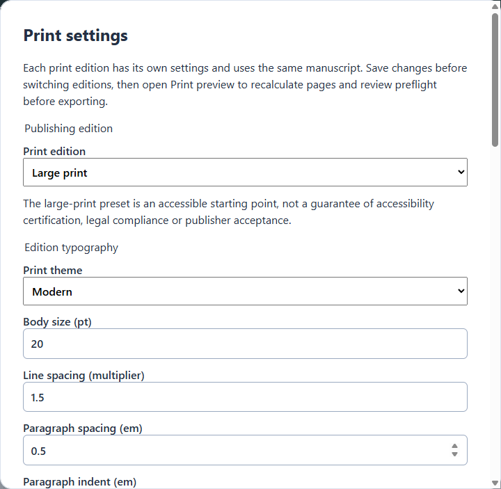

# Large-print publishing edition

Community provides two fixed print editions: **Standard print** and **Large print**.
Both use one authoritative manuscript and the existing theme, pagination, PDF
preview, preflight and export pipeline. EPUB keeps its own presentation theme.
There are no manuscript copies, alternative renderers or general edition manager.

## Using an edition

Open **Book design → Print settings → Print edition**. Switching saves the selected
edition; save any outstanding settings first. A failed save or switch retains the
current edition and draft. Each edition independently retains its print theme,
typography overrides, trim, margins, additional gutter, chapter starts, headers
and page numbering. Reopening the project restores both profiles and the selected
edition. Changing EPUB's Book theme does not change either print profile.

Open **Print preview** after saving to paginate the selected edition. Its name is
shown above the PDF. Review its pages and preflight findings before exporting.
The preview revision includes edition identity, resolved typography, layout,
manuscript revision and bundled fonts. Export checks current source identity before
destination selection and again before publication, then writes the exact preview
bytes. Switching editions or changing that edition's settings requires a refreshed
preview. Changes to the other profile or EPUB presentation do not change its output.

## Starting values and overrides

Large print starts with Modern, bundled Noto Sans, 18 pt body, 1.5 line spacing,
0.5 em paragraph spacing, no first-line indent and left alignment. Trim is 6 × 9
inches, margins are 0.75 inches on all sides, and the additional gutter is 0.125
inches. These deliberately reuse the Community geometry defaults. Running headers
and folios use 80% of body size with a 14 pt minimum; insufficient margin space is
reported as blocking overflow. Standard print retains the existing 9 pt running
matter. Headers and folios can be disabled independently.

Both editions allow body sizes of 9–32 pt, line spacing of 1.2–2.5, paragraph spacing
of 0–1 em, indentation of 0–2 em, left/justified alignment and all existing physical
print settings. Theme selection determines the bundled serif/sans family and
chapter/quote/scene-break styling. Overrides remain when changing a print theme.
No arbitrary CSS, font files, paths or network resources are accepted.

The large-print preset provides an accessible starting point, not a guarantee of
accessibility certification, legal compliance or publisher acceptance. Authors can
override it, including choosing smaller type. Review an actual printed proof and
the intended reader and printer requirements.

## Per-edition preflight

Each render independently recalculates pagination, mirrored margin geometry,
clipping, overflow, page boxes and embedded fonts. An edition exceeding 300 pages
with less than 25.4 mm combined inside margin and gutter receives a binding-space
review warning. This is a conservative Community review reminder, not a calculated
binding requirement or publisher profile. Paper stock and binding are not modelled.
Review the printer's requirements, adjust that edition and repaginate. Warnings
require acknowledgment for the exact preview revision; invalid geometry and
measured clipping/overflow remain blocking errors.

## Persistence and compatibility

`print.json` version 2 contains `projectId`, `edition` (`standard` or `large-print`)
and `editions`, with exactly those two keys. Each profile has `settings`, `themeId`
and bounded `typography` overrides. EPUB continues to use `presentation.json`.
Project, book, publication and chapter schemas/content remain unchanged.

Absent or version-1 print configuration is read without writing: existing geometry
and the legacy shared theme become Standard's initial profile; Large print gets
the defaults above. The first explicit print save/switch atomically writes version 2. Before changing a legacy EPUB theme, core first atomically persists the old
print appearance under the existing project lock, then changes the EPUB theme.
If interrupted between those writes, print appearance and the previous EPUB theme
remain intact; retry is safe. This ordering requires no destructive manuscript
migration or multi-file rollback. Once separated, the profiles never inherit later
EPUB theme changes. Unavailable legacy themes retain their previous Classic print
fallback; the original saved EPUB identity is preserved.

Stale drafts, malformed/newer components, foreign project IDs and retained recovery
files are rejected. Failed atomic writes preserve the previous valid configuration.
Portable archives include both profiles. Older applications reject version 2 for
print operations rather than silently flattening it; ordinary manuscript recovery
remains independent of print configuration. Keep backups when using older versions.

## Verification

Core tests cover independent settings, switching, reopening, archive restoration,
legacy conversion, failed writes and byte-identical manuscript files. Desktop tests
cover dirty/failed switches, typography validation and stale export rejection,
including a switch during destination selection. The offline Chromium print test
compares Standard and Large print extracted prose, pagination and exact exported
PDF bytes through the shared production pipeline. Platform evidence is limited to
the platforms on which those tests have actually run; #131 retains broader release
validation.

Windows verification on 13 October 2026 passed frozen-lockfile installation, lint,
format check, typecheck/build, the full unit suite (1,014 tests), subsequent focused
tests (14 tests, including interrupted legacy conversion), and the workspace and
Community boundary checks. The offline Chromium PDF comparison and Electron
settings/switch/restart tests passed. Larger type exposed a long unbroken heading
overflow in the synthetic fixture; the test verifies that preflight blocks it,
then compares the proof after shortening that heading in both fixture editions.
Explicit discretionary hyphens are normalised when comparing extracted prose
because different line breaks can make them visible. macOS/Linux execution and
accessibility certification were not performed by this change.
