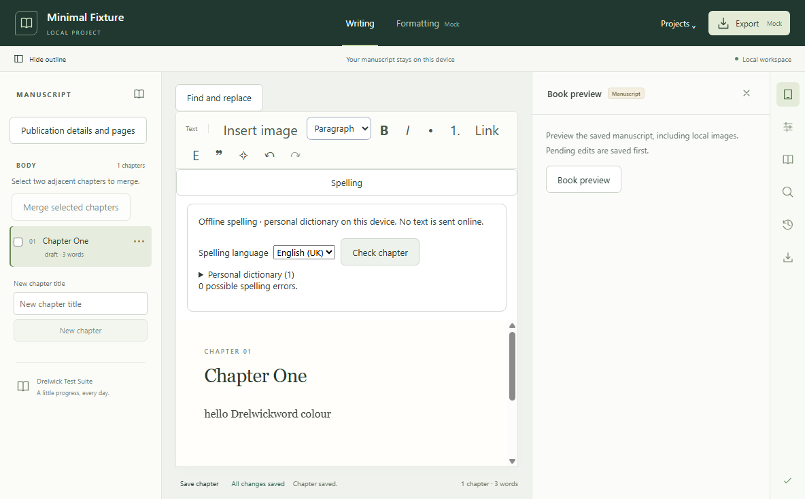

# Offline spelling (CORE, issue #132)

## Strategy decision before adding dependencies

Electron 39's native checker is unsuitable for the complete cross-platform
contract: macOS ignores explicit language selection, and Windows/Linux default to
downloading dictionaries from Chromium's CDN. See the
[Electron session API](https://www.electronjs.org/docs/latest/api/session).
Disable native spell checking for the editor window, and use bundled local
Hunspell-format resources with a small typed checker interface instead.

Selected dependencies: `nspell` 2.1.5 (MIT), `dictionary-en` 4.0.0 and
`dictionary-en-gb` 3.0.0 (dictionary/affix data MIT AND BSD; packaging MIT).
[nspell](https://github.com/wooorm/nspell) is a JavaScript Hunspell-compatible
checker with no native compilation or service requirement.
[wooorm/dictionaries](https://github.com/wooorm/dictionaries) packages upstream
SCOWL/English word lists; it does not maintain their spelling content.
The pinned dictionaries identify their underlying data as SCOWL 2020.12.07.
These are mature dependencies, not a promise of current vocabulary coverage;
pin versions and regression-test actual bundled data when upgrading.
No promise of complete Hunspell compatibility or perfect linguistic accuracy.

The same pure JavaScript engine and packaged English (US/UK) resources run on
Windows, macOS and Linux, independently of host-installed dictionaries. No
native binary, OS dictionary write, account, Pro package or runtime download is
required. Retain upstream licence texts in dependency distributions and in the
repository's [spelling attribution directory](attributions/spelling/README.md). This dependency choice does not
select a licence for Drelwick itself.

## Author workflow



Open **Spelling** above the chapter, select **English (US)** or **English (UK)**,
then choose **Check chapter**. The default for a new device is US English;
the selection is explicit and independent of project metadata and OS locale.
Checking is on demand, not automatic underlining. It checks the current live
chapter, including unsaved text, and lists possible errors in document order.
Choose **Show in chapter**, **Suggestions**, **Skip occurrence** or **Add to
personal dictionary**. Only **Replace with …** changes manuscript text. Replacement
is a normal editor transaction, retains the starting text's marks and participates
in ordinary undo, redo, dirty state and autosave. Check again after a replacement
or other document edit; stale reviews and in-flight results are discarded.

Expand **Personal dictionary** to add an exact word or remove one. Words retain
case and Unicode code points, apply to both languages and all local projects,
and persist across app restarts. They are an allow-list, not a second source of
suggested replacements. A personal entry does not alter the bundled dictionary.
Words contain letters/combining marks and internal apostrophes/hyphens, up to
128 UTF-16 code units; settings allow at most 10,000 entries. Longer manuscript
words are skipped with a visible count. Suggestions are limited to words up to
64 code units and eight results, with a visible explanation for longer words.
Text joins across formatting marks, never across blocks, hard breaks or images;
metadata/attribute text (such as image alt text) is not checked. Grammar, rewriting
and whole-book revision are outside this feature.

## Offline availability, security and storage

US and UK resources ship as pinned production dependencies on every platform.
There is **no runtime download path** and no host dictionary dependency. A missing,
unsupported or broken language resource is reported in the panel while editing,
undo and saving continue. Choose an available language or repair the installation;
spelling never fetches a replacement dictionary. Packaging must retain both
dictionary packages, their affix/word files, the worker and their licence notices.
Installer delivery remains the separate packaging issue #107.

The main process owns a fixed `spelling.json` under Electron's `userData` directory:

```json
{ "schemaVersion": 1, "language": "en-US", "words": ["Drelwick"] }
```

This is new application-level storage, not a project format change. Existing
projects need no spelling migration, and project backups do not include this
device's dictionary. Missing settings use defaults; malformed/newer settings
fail closed and are never overwritten. Preserve a copy of `spelling.json` before
repairing it. Updates serialize and use the existing atomic writer; a failed save
retains the previous valid file and does not change the displayed setting.

The renderer receives only `get`, `update`, `check` and `suggest`. Main verifies the
live window, main-frame identity and exact trusted URL, and validates strict Zod
payloads, including batch/word bounds. Renderer requests cannot choose paths,
resource modules or URLs. Only batches of up to 256 distinct words cross local
IPC; they never enter logs or network requests. Errors have fixed messages without
author input. The worker loads only literal bundled modules, handles CPU-intensive
suggestions outside the UI/main thread and is terminated after a five-second task
deadline. Failure disables that operation, never the editor; later requests can
start a fresh worker. Native spelling/autocorrection is disabled, and Electron's
sandbox, context isolation and Node restrictions remain in place.

## Acceptance evidence

Dependencies #24 (editor, merged PR #90) and #30 (persistence, merged PR #97) are
closed and present in this branch. Product classification: CORE / `product:core`.

| #132 acceptance criterion                                                 | Implementation and executable evidence                                                                                                                                                                                                                                              |
| ------------------------------------------------------------------------- | ----------------------------------------------------------------------------------------------------------------------------------------------------------------------------------------------------------------------------------------------------------------------------------- |
| Document platform strategy, availability, licensing and offline behaviour | This document and copied upstream notices; `spelling-adapter.test.ts` loads pinned resources in the real built worker without host dictionaries.                                                                                                                                    |
| Explicit language selection and persistent personal dictionary            | `SpellingPanel`; `core/test/spelling.test.ts` checks restart, exact Unicode/case, serialized updates, removal, failed writes and unavailable languages; `spelling-settings.test.ts` validates version and limits. Native Electron test changes language and reopens saved settings. |
| Suggestions never silently modify text                                    | `spelling-editor.test.ts` verifies checking/suggestions leave JSON unchanged and produce no editor update; verifies stale response/range rejection, batching and read-only protection. Electron test compares on-disk bytes before replacement.                                     |
| Missing resources clear; downloads opt-in; editing continues              | No download capability exists. Panel, core and Electron tests cover unavailable resources and continued editing/saving. `spelling-worker-failure.test.ts` covers timeout/crash/exit and retry.                                                                                      |
| Local manuscript text, ordinary undo/save                                 | Renderer test covers marks, positions, editor updates and undo/redo. Native Electron scenario exercises real preload/worker, undo/redo, autosave, disk content and restart, intercepts HTTP(S)/WebSocket attempts and checks application logs for synthetic author content.         |

`spelling-ipc.test.ts` additionally checks rejected frames/windows/URLs, extra
fields, path-like inputs, oversized batches and sanitized errors. Preload and
window tests protect the restricted API and disabled native spelling. Fixtures and
adapters are deterministic; the only full-dictionary assertions use pinned bundled
resources. The Electron scenario is executed on Windows; native macOS/Linux and
installer verification are not claimed. Community builds without Pro packages.

### Validation on 28 September 2026

All five #132 acceptance criteria pass the evidence above. The resumed session
found nine tracked modifications and eight new files at base `6e61451`, with the
service/worker/IPC and draft strategy present but no editor workflow or spelling
tests. No truncated source files were found; the inherited code built. The session
completed the workflow, tests, attribution notices and documentation, including a
regression fix so unrelated stored typing marks cannot affect a replacement.

| Command                                                                             | Result                                                                                                                                      |
| ----------------------------------------------------------------------------------- | ------------------------------------------------------------------------------------------------------------------------------------------- |
| `pnpm install --frozen-lockfile`                                                    | PASS                                                                                                                                        |
| `pnpm lint`                                                                         | PASS after fixing regex escapes and effect cleanup lint findings                                                                            |
| `pnpm format:check`                                                                 | PASS                                                                                                                                        |
| `pnpm typecheck`                                                                    | PASS after updating the typed API fixture and new test mocks                                                                                |
| `pnpm test`                                                                         | PASS: 79 files, 932 tests before the final marks regression test                                                                            |
| `pnpm test:coverage`                                                                | PASS: 79 files, 933 tests including that regression                                                                                         |
| `pnpm build`                                                                        | PASS, also executed by typecheck/test/coverage/workspace scripts                                                                            |
| `pnpm check:workspace`                                                              | PASS; Community-only consumer                                                                                                               |
| `pnpm exec tsc -p tsconfig.test.json`                                               | PASS after correcting strict test types                                                                                                     |
| `pnpm exec playwright test --grep 'offline spelling'`                               | PASS after correcting an unsupported native-preference assertion in the new test; security options remain asserted in `main-window.test.ts` |
| `pnpm test:e2e`                                                                     | FAIL: 14 passed, existing ebook-preview navigation scenario failed                                                                          |
| `pnpm exec playwright test --grep 'reflowable ebook'`                               | FAIL: same expected chapter hash versus empty hash                                                                                          |
| `pnpm test:e2e --grep 'reflowable ebook'` in a fresh detached worktree at `6e61451` | FAIL: identical navigation failure without any #132 changes, after its own frozen install/build                                             |
| `git diff --check`                                                                  | PASS                                                                                                                                        |

The initial `pnpm test:e2e --grep 'offline spelling'` failed on the test's use of
an undocumented preference getter (which omitted `spellcheck`). That assertion
was replaced with checks at the actual window-option boundary and runtime checks
for absent Node/IPC/filesystem globals. The complete spelling workflow subsequently
passed in isolation and in the full Electron run. No existing test was weakened.

Targeted Vitest commands also passed:

```sh
pnpm exec vitest run apps/desktop/test/manuscript-document.test.ts apps/desktop/test/editor-toolbar.test.ts packages/core/test/chapter-saving.test.ts apps/desktop/test/preload.test.ts
pnpm exec vitest run packages/core/test/spelling.test.ts apps/desktop/test/spelling-editor.test.ts apps/desktop/test/spelling-ipc.test.ts apps/desktop/test/spelling-adapter.test.ts
pnpm exec vitest run apps/desktop/test/spelling-worker-failure.test.ts packages/project-model/test/spelling-settings.test.ts
pnpm exec vitest run apps/desktop/test/spelling-editor.test.ts
```

The pre-existing ebook-preview navigation failure remains outside #132. Native
macOS/Linux execution and packaged installers remain unverified; no merge was
performed. Build output retains the existing Vite large-chunk warning.
