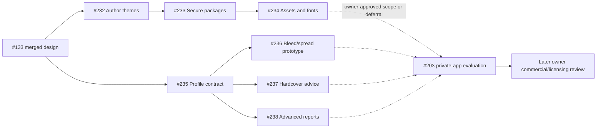

# #133 publishing/theme assessment and delivery matrix

Design-contract revision 1. Baseline: clean `main` at `eebc6e9` (merged #231).
The complete #133 issue, its #109 planning source, #122/#128 prerequisites,
#203 owner gate, PRs #190/#212/#214 and current implementation were inspected.
This is design/research, **CORE**, not implementation of advanced publishing or
approval of a commercial allocation. The [theme design](../custom-themes.md) and
[package format](../theme-package-format.md) are normative proposed contracts.

## 1. Verified foundations, reusable APIs and actual gaps

| Source               | Merged evidence / actual implementation                                                                                                                                                                                                       | Reuse and limits                                                                                                                                                                                                                                                                                                    |
| -------------------- | --------------------------------------------------------------------------------------------------------------------------------------------------------------------------------------------------------------------------------------------- | ------------------------------------------------------------------------------------------------------------------------------------------------------------------------------------------------------------------------------------------------------------------------------------------------------------------- |
| #122 / PR #190       | Merge `0ff540a11ce75c13c84405c987530d28d155355c` is an ancestor. `BookThemeSchema`, `BookPresentationSchema`, `getBookTheme`, `resolveBookTheme`, `generateThemeStyles`, `readBookPresentation`, `saveBookTheme` and desktop selectors exist. | Three strict built-ins; six CSS goldens; separate presentation; exact prose preservation. The current schema accepts only built-in IDs and typed tokens; `requiredAssets` is empty. No custom registry, package importer, asset resolver or font editor exists.                                                     |
| #128 / PR #212       | Merge `5215f22d3e51df36b6f31a637b00f4cc6c2207cd` is an ancestor. Model/shared print settings, `printPageGeometry`, `load/read/savePrintConfiguration`, strict IPC and modal exist.                                                            | Integer micrometres, five trim presets/custom sizes, mirrored margins/additional gutter, starts, running headers/folios and stale-safe persistence. These are already CORE, including useful binding settings. No bleed geometry or printer profiles.                                                               |
| #129 / PR #214       | Merge `35b80791b983d8a6976f37efa146642211f378da` is an ancestor. `renderPrintRevision`, `createPrintSurface`, production section PDFs, PDF-lib composition and bundled PDF.js exist.                                                          | One actual-PDF preview/export pipeline; recto blanks and embedded Noto fonts. Present print CSS forces one font family across body/headings; imported font sets require deliberate extension. Trusted bundled font parsing is not an untrusted-package parser.                                                      |
| #130 / PR #215       | Merge `28fc8fc417e05600d0b81cf21b53e005f83025ed`; current `printPreflight`, `printSourceRevision`, `inspectPrintPdf` and atomic PDF export inspected.                                                                                         | Reuse revision-bound exact-byte output, staged validation, destination checks and warning acknowledgement. Checks include geometry/page boxes, embedded font programs, metadata, missing assets/fonts, overflow/clipping, blank pages and binding-space review. No PDF/X, colour/DPI or publisher-acceptance claim. |
| #136 / PR #217       | Merge `53b983ac798af700a604b395af08de6483fde792`; current print envelope v2 and `printTypography` inspected.                                                                                                                                  | Standard/Large-print profiles and typography overrides already exist. Do not reproduce an edition manager, paywall manual typography/gutters or reset EPUB when editing print.                                                                                                                                      |
| EPUB/core/desktop    | `assembleBook`, `renderBook`, `generateEpub`, `validateEpubArchive`, prepared ebook preview, export destination/atomic writer and #173 projection choice inspected.                                                                           | Shared semantic renderer, generic-only current EPUB CSS, complete saved-source capture and explicit pending-revision export policy. No portable custom fonts/ornaments in EPUB today.                                                                                                                               |
| Persistence/security | `withReferenceLock`, atomic writers, #170 context transactions, #171 strict snapshots, project archive and restricted preload inspected.                                                                                                      | Extend existing gates and capture protocols. Current archive directory allowlist and snapshot file whitelist do **not** automatically support a new `themes/` store. Custom selection must wait for their closure/restore tests.                                                                                    |

#122 and #128 are closed **and implemented**, not merely listed as done.
Six focused prerequisite suites were executed: renderer themes, core presentation,
model/core print configuration, desktop print render and export: **47 tests PASS**.
The source PRs' old test/platform counts are historical evidence, not results of
this design branch. #131 and #208 retain output/platform/reader validation scope;
their open status does not mean new publishing features are already certified.

Current Community constraints: no arbitrary CSS/HTML; generic-only EPUB export;
print's licensed Latin font inventory; section-based Chromium fragmentation;
2,000 pages, 1,000 sections, 64 MiB print output and bounded render deadlines.
Ordinary authoring/publishing stays offline and independent of later capabilities.

## 2. Independent assessment A: full-bleed and spread images

**Feasibility:** plausible as bounded explicit page-level placement/composition
through the existing print pipeline; not achievable by setting ordinary manuscript
image width to 100% or making the paper bigger. A prototype must demonstrate actual
PDF box/clipping correctness before a user-facing shipping commitment.

Use integer micrometres for requested trim/bleed/insets; convert once to PDF points
with `points = micrometres * 72 / 25400`. For requested exterior bleeds L/R/T/B,
physical media is `(W + L + R, H + T + B)`; in bottom-left PDF coordinates the trim
rectangle starts at `(L,B)` with size `(W,H)`. Define MediaBox, TrimBox, BleedBox
and CropBox explicitly and verify their containment and origin. Crop policy must
show bleed for inspection while the trimmed-view overlay shows the finishing edge.
Do not simply change box metadata without painting content into the bleed area.
The current inspector expects all principal boxes at zero-origin trim dimensions;
an advanced contract requires versioned geometry-aware inspection, not disabling it.

Facing preview remains display-only. A spread is a deliberate logical image
placement spanning two **separate physical pages** by default, not one double-width
PDF page. Split the same captured original into defined left/right clipping
rectangles; show gutter loss/safe areas, seam and focal cropping. Handle recto/verso,
intentional blanks, chapter starts and trim consistently. A publisher-requested
single-sheet spread is a different output profile, never an implicit default.

Source resolution uses original pixel dimensions and the final placed/cropped
physical size: `effectivePPI = pixels * 25400 / placedMicrometres` per axis; crop,
rotation/scaling and duplicated halves must be included. Do not infer PPI from EXIF
alone or upscale a low-resolution source and claim it improved. Keep the original,
validate bounded derivatives and report target-profile thresholds without adopting
a universal printer requirement.

Reflowable EPUB keeps one semantic narrative image, reading order and alt text.
It can fit the reading viewport but cannot promise a physical seam, bleed or fixed
facing pages. Do not silently convert the book to fixed-layout EPUB. A future
fixed-layout edition would require its own explicit scope, accessibility and reader
tests. Theme ornaments remain decorative and cannot stand in for this content model.

**Dependencies/gaps:** #113 managed images and #112 semantics, current #129/#130
pipeline, versioned profile/geometry inputs, asset capture, page-level painting and
independent PDF inspection. Repeated uses of one `assetId` are not unique image
occurrences. Any persisted placement needs an explicitly designed stable occurrence
identity/migration plus chapter/revision mapping; no title/quote/offset guessing.
The prototype uses synthetic frozen inputs and must record that identity decision
before any production format change. Theme editing/package support is not a
technical prerequisite for the prototype.

**Go/no-go evidence:** single page, two physical pages, mixed trim/bleed, changed
crop, recto separator, low PPI, transparent/rotated image, missing original,
overflow and maximum-resource cases. Inspect all PDF boxes/content clipping and
compare PDF-backed preview pixels with exported bytes on supported platforms.
Physical print/binding proofs remain necessary. Colour management, PDF/X, imposition
and printer acceptance are not demonstrated by a successful picture render.

## 3. Independent assessment B: hardcover convenience

**Already Community:** custom trim, mirrored inside/outside margins, additional
gutter exactly once, recto starts, headers/folios, Standard/Large-print typography,
PDF proof and ordinary validation. A suitable manually configured hardcover
**interior** is not intrinsically a Pro feature. Do not add a paywall or remove
custom dimensions because a binding is called hardcover.

**Candidate additions:** locally stored, source-attributed printer/binding/paper
profiles; non-authoritative minimum-margin/trim/page-count checks; explicit suggested
gutter values; revision-bound review reports. Never overwrite a user's settings
automatically. Recommendations need actual binding/stock/page-count inputs and
explicit uncertainty; no universal formula or fixed number is selected in #133.
Apply approved suggestions as one ordinary validated print-settings save, preserving
the other edition, EPUB, source text and previous valid state. Re-pagination is
required after geometry changes; never claim the page count converged until tested.

**Separate workflows:** case wrap, boards, hinges, joint widths, spine lettering,
cover panels, dust jackets and endpapers differ from an interior page. Existing
publication cover metadata/image is an ebook/publication cover, not a manufacturing
template. A spine-width estimate needs the selected paper's verified caliper,
binding, page-count method and provider instructions; it cannot certify a cover.
Endpapers may be separately supplied or printer-provided and are not silently added
to manuscript page counts. Cover/endpaper generation, ISBN/vendor upload, physical
proof ordering and printer integration are excluded from the first convenience issue.

**Feasibility/dependencies:** a bounded assistant over #128/#136 settings and the
versioned publisher-profile contract is feasible without changing rendering or prose.
Paper/cover production and manufacturer-specific rules remain external requirements.
Test several synthetic binding profiles and explicit unsupported/unknown values;
compare source bytes/edition settings and physical geometry after failed saves,
undo/cancel and reopen. Human review must verify the exact provider document/version
and a physical proof. Expired/unverifiable instructions are warnings or unsupported,
not a green compliance badge.

## 4. Independent assessment C: advanced publisher preflight

**Existing Community findings stay visible and cannot be suppressed** by a theme,
profile, commercial capability or report. Current font-program presence is not a
licence check; measurable clipping is not exhaustive collision/glyph-ink detection;
basic page boxes do not prove bleed, colour management, PDF/X or PDF/UA.

Split reusable **publisher-profile data/provenance** from the reporting/check runner.
The proposed profile is strict versioned passive data: immutable UUID/version/hash,
provider/product/binding/region identifiers as text, source document and verification
date, explicit unitful constraints, required check capabilities and expiry/review
policy. Rule vocabulary is finite comparisons over declared measurements. No code,
regular expressions supplied by packages, arbitrary selectors/queries, network
refresh, credentials or executable profile plugins. A source URL is display/provenance
only and is never auto-opened/fetched by validation.

Potential checks: profile-specific trim/page-count/margin/safe-area constraints;
effective image resolution after cropping/scaling; requested vs actual font faces/
embedding/subsetting and **unverified** rights metadata; bleed/trim/content bounds;
colour-space/ICC/output-intent/transparency observations where a reviewed inspector
can measure them. Unknown extraction, unsupported encrypted/malformed data, missing
profile inputs or absent check capabilities produce **not verified**, never Pass.
V1 does not convert RGB to CMYK, flatten transparency, relabel boxes, substitute
fonts or repair output behind the author's back. A colour observation is not
colour-managed output or a guarantee of colour on paper.

Each finding/report binds exact source generation, output hash, target/edition,
profile ID/version/hash and inspector/tool versions. Include severity, fixed code,
page/chapter/asset locator where safe, expected/measured units and remediation.
Stable order is page, logical locator and code. Cache only by exact inputs; source
or profile changes invalidate warning acknowledgement. Reports are read-only and
exclude manuscript/private editorial text by default. A user explicitly chooses
any report export and whether bounded excerpts are included; ordinary output does
not inherit report or publisher-private metadata.

**Feasibility/dependencies:** versioned profiles and bounded checks over existing
render measurements/PDF inspection are feasible independently of custom themes.
Bleed-specific claims depend on the placement/geometry prototype succeeding and
being integrated explicitly; without it, report unsupported. Formal conformance
claims such as PDF/X or PDF/UA require independent standards-aware validators and
dedicated evidence, not a renamed Community check. No third-party validator or
publisher API is selected here. Provider acceptance also depends on current rules,
manual review and manufacturing facts unavailable locally. Never guarantee upload
acceptance or call a local result certification.

## 5. Product-boundary matrix (2 October decision)

The new `product:undecided` triage label records pending allocation; it is not a new
licensed product or approval to create Pro. The exact status for every unapproved
commercial assignment is **Undecided — owner review after #203**.

| Capability                                                                                                                                                                                         | Existing commitment / technical boundary                                                                                                                       | Allocation                                                      |
| -------------------------------------------------------------------------------------------------------------------------------------------------------------------------------------------------- | -------------------------------------------------------------------------------------------------------------------------------------------------------------- | --------------------------------------------------------------- |
| Ordinary novel authoring, built-in themes, EPUB, basic publishable PDF, current fonts/fallbacks, manual trim/margins/gutter, Standard/Large-print settings, basic validation, local backup/restore | Preserve working Community operation offline without account, runtime add-on or artificial restriction.                                                        | **CORE**, unchanged                                             |
| Public/passive schema, renderer and security architecture; safe shared persistence contracts                                                                                                       | This #133 design is Community foundation. Future common APIs must remain usable without Pro; architecture is not a promise that every later UI/asset is free.  | **CORE** foundation                                             |
| Author-created typography, chapter openings and custom presentation editor                                                                                                                         | Author owns their data; no prose rewrite or separate renderer. Cannot reclassify existing manual typography/settings as a new paid feature.                    | New functionality: **Undecided — owner review after #203**      |
| Local theme import/export and font/decorative resource convenience                                                                                                                                 | Declarative validated packages; ownership/permissions distinct from Drelwick entitlement. No marketplace or plugin runtime.                                    | New feature allocation: **Undecided — owner review after #203** |
| Full-bleed/spread placement, hardcover recommendations, advanced profiles/reports                                                                                                                  | Independent feasibility/evidence; manual ordinary printing remains Community. Technical work can be evaluated privately without Pro infrastructure.            | **Undecided — owner review after #203**                         |
| Premium first-party theme artwork/font bundles                                                                                                                                                     | Asset rights, price/distribution and software rights are separate. No exclusive asset may become required to reopen/render an ordinary Community project.      | **Undecided — owner review after #203**                         |
| Third-party theme packages                                                                                                                                                                         | ECOSYSTEM describes provenance/possible distribution, not trust, a marketplace, royalties or an approved commercial tier. Same strict offline package gateway. | Commercial allocation: **Undecided — owner review after #203**  |

Existing CORE functionality is not moved. These rows supersede older shorthand
that labelled premium themes or advanced publishing **PRO** before owner review.
#203 evaluates the complete private candidate and approves technical scope or
explicit deferrals; #52/#53/#54/#60 retain later commercial/licensing/release gates.
Neither #52 nor final allocation is a prerequisite to preserving/improving existing
CORE functionality. Do not make #203 depend on a new Pro repository, and do not
make these implementation issues depend on #203 in a cycle. Technical scope/readiness
approval is distinct from final product allocation.

## 6. Implementation roadmap and duplicate reconciliation

Search covered all open/closed issue titles and body searches for theme, font,
ornament, full bleed, spread, hardcover, preflight and publisher profile on the
baseline. #122/#128/#129/#130/#136 are foundations, #131/#208 validation gates,
#134/#135/#137 adjacent design scopes, #52 commercial review and #203 evaluation;
none is a duplicate custom-theme implementation or advanced profile/placement issue.
After completing the design/fixture review and duplicate search, the seven issues
below were created with concrete acceptance tests. They remain Backlog with
`product:undecided`, not approved commercial allocations or automatic v1.0 scope.

| Stable task                                                      | Follow-up scope                                                          | Technical prerequisites                                                                               | Exclusions / sequencing                                                                                                                                                                      |
| ---------------------------------------------------------------- | ------------------------------------------------------------------------ | ----------------------------------------------------------------------------------------------------- | -------------------------------------------------------------------------------------------------------------------------------------------------------------------------------------------- |
| CT1 / [#232](https://github.com/DarrenPratt/Drelwick/issues/232) | Custom author-theme editing, pinned persistence and renderer adapters    | #133 merged; #122/#128/#136 implementations; #170/#171 context/backup and #173 projection integration | Built-in fonts/simple ornaments first; no package import, untrusted font parsing, Pro or new semantic renderer. Include archive/snapshot closure before selection can be saved.              |
| CT2 / [#233](https://github.com/DarrenPratt/Drelwick/issues/233) | Secure local theme package import/export                                 | CT1; existing archive/destination/atomic primitives                                                   | Asset-free packages first. Strictly reject unsupported resource capabilities until CT3; no extract-all, scripts, auto-apply or marketplace.                                                  |
| CT3 / [#234](https://github.com/DarrenPratt/Drelwick/issues/234) | Decorative raster assets and licensed static font handling               | CT1 + CT2; #113 image validation and current print/font pipeline                                      | Isolated resource parsing, target rights/asset closure, renderer/EPUB/print integration; no system install, remote fonts, arbitrary SVG/CSS or advanced narrative placement.                 |
| AP1 / [#235](https://github.com/DarrenPratt/Drelwick/issues/235) | Publisher-profile data, provenance and deterministic validation contract | #133 merged; #128/#130/#136 measurement vocabulary                                                    | Shared finite rules, no report UI, binding assistant, arbitrary rule code or publisher acceptance promise. Separate to avoid three incompatible profile formats.                             |
| AP2 / [#236](https://github.com/DarrenPratt/Drelwick/issues/236) | Bounded full-bleed/spread prototype and recorded go/no-go                | AP1; #112/#113/#129/#130 production pipeline                                                          | Synthetic frozen inputs/PDF proof first. No production manuscript schema/occurrence migration or shipping feature until the prototype's geometry/identity decision is reviewed.              |
| AP3 / [#237](https://github.com/DarrenPratt/Drelwick/issues/237) | Hardcover interior convenience over existing settings                    | AP1; #128/#129/#130/#136                                                                              | Explicit profile-driven suggestions only; no cover/case wrap/spine/endpaper generator, uploads or automatic settings changes.                                                                |
| AP4 / [#238](https://github.com/DarrenPratt/Drelwick/issues/238) | Advanced local profile preflight and report runner                       | AP1; #129/#130 inspection                                                                             | Add measured checks without suppressing Community results; AP2 optional capability prerequisite only for bleed claims. No PDF/X/UA certification, colour conversion or publisher guarantees. |

Dependency order: CT1 → CT2 → CT3; separately AP1 → AP2/AP3/AP4. No dependency
between custom themes and the advanced image prototype. Existing #131 platform
validation can supply evidence without becoming proof these later features exist.
The [complete issue specifications](133-follow-ups/ct1.md) are retained alongside
this design (CT2, CT3, AP1, AP2, AP3 and AP4 are sibling files).
Each issue starts **Backlog**, with product allocation undecided and no automatic
v1.0 commitment. #203 incorporates only owner-approved implementation scope or
explicit recorded deferrals. Do not silently expand v0.1 or the Community baseline.

## 7. Acceptance/review matrix

| Case                          | Design review / future implementation acceptance                                                                                                                                                                                                                                       |
| ----------------------------- | -------------------------------------------------------------------------------------------------------------------------------------------------------------------------------------------------------------------------------------------------------------------------------------- |
| T01 ordinary Community novel  | All built-ins, generic EPUB, current print/large-print and manual geometry work with no custom packages/Pro/network; preserve current goldens and bytes.                                                                                                                               |
| T02 author theme              | Copy a built-in, change body/headings/paragraph/opening/quotes/scene break, save/duplicate/reopen/restore, compare source bytes and semantic reading inventory; target/edition overrides remain isolated.                                                                              |
| T03 font/asset unavailable    | Role-specific fixed diagnosis; refuse broken import; preserved pin and explicitly chosen operation-only fallback; no silent system/remote font or image loss.                                                                                                                          |
| T04 malicious package         | Reject active keys, unsupported versions/capabilities, traversal/encoded/drive/UNC/ADS paths, device names, duplicates, links, mismatched headers/CRC/hash/type, bombs/understated sizes, malformed JSON/fonts/images and time/heap exhaustion. Source/project/output bytes unchanged. |
| T05 interrupted/stale writes  | Fault-inject staging, validation, directory publication, selection replacement and acknowledgement. Reopen a complete previous/current state; no dangling selected bundle. Never steal live/foreign locks or replay stale tokens.                                                      |
| T06 compatibility/portability | Presentation v1/print v1/v2 map on explicit save; current built-in goldens remain; future/corrupt versions survive refusal. Archive and named snapshots include exact pinned resource/notice closure and restore offline into independent projects.                                    |
| T07 rights                    | Missing notice/permission, conflicting fsType, no-subsetting, allowed PDF but prohibited EPUB/package redistribution: do not conflate operations. Preserve notices; no inferred legal certification.                                                                                   |
| T08 advanced images           | Actual PDF boxes, paint/clipping and effective PPI checked on each physical page; spread seam/facing preview agrees with final bytes. Reflowable EPUB remains one semantic image with alt text.                                                                                        |
| T09 hardcover                 | Existing manual Community layout remains; recommendations require exact profile/stock/page-count inputs and explicit apply. Unknown instructions cannot produce a compliance pass; no invented cover output.                                                                           |
| T10 advanced preflight        | Exact output/profile/tool identity, deterministic findings, unknown/not-verified results, source change invalidation and privacy-safe reports. Community errors cannot be suppressed.                                                                                                  |
| T11 offline/accessibility     | Denied network and unapproved resource requests; keyboard/focus, reader text-size/colour override, semantic order/alt text, cancellation, dirty navigation and three-platform native/reader evidence.                                                                                  |
| T12 no Pro dependency         | Community architecture check/build without Pro; no new workspace/plugin runtime, account, licence switch, cloud or executable theme/profile.                                                                                                                                           |

#133 executes example schema/graph/inventory conformance and repository checks;
T01–T12 are also mandatory follow-up runtime/manual tests. Design fixtures are not
an implemented ZIP importer, font sandbox, advanced PDF renderer or publisher proof.

## 8. Primary references and remaining owner decisions

- [EPUB 3.3 layout model](https://www.w3.org/TR/epub-33/#sec-rendering): reflow is distinct from fixed layout; Drelwick keeps current EPUB reflow in this design.
- [Electron printToPDF API](https://www.electronjs.org/docs/latest/api/web-contents/#contentsprinttopdfoptions): page-size/CSS printing capabilities do not alone establish production bleed correctness. Implementation must use the repository-pinned runtime.
- [PDF 32000-1, 14.11.2 page boundaries](https://opensource.adobe.com/dc-acrobat-sdk-docs/pdfstandards/PDF32000_2008.pdf): distinct physical/visible/trim/bleed boundaries; the proposed composition still needs measured proof.
- Font and ZIP sources/rights cautions are linked in the [package specification](../theme-package-format.md).

Owner decisions still required: approved private v1.0 implementation scope versus
deferral under #203, final allocation under #52 after evaluation, any premium asset
rights/business terms, approved third-party distribution policy, and exact supported
printer/profile sources. No provider limits, asset purchase, licence change,
public release, Pro repository or manufacturing guarantee is approved here.

## Validation record

Executed on Windows, Node 24.18.0 / pnpm 10.34.5, 4 November 2026:

| Check                                 | Result                                                                                                                                                                     |
| ------------------------------------- | -------------------------------------------------------------------------------------------------------------------------------------------------------------------------- |
| `pnpm install --frozen-lockfile`      | PASS; no dependency/lockfile change                                                                                                                                        |
| Focused prerequisite suites           | PASS: 6 files / 47 tests                                                                                                                                                   |
| Theme design examples                 | PASS: 1 file / 30 tests; strict manifest, references, rights, inventories and known ZIP fixtures                                                                           |
| `pnpm lint`                           | PASS                                                                                                                                                                       |
| `pnpm format:check`                   | PASS                                                                                                                                                                       |
| `pnpm typecheck`                      | PASS, including test TypeScript                                                                                                                                            |
| `pnpm test`                           | PASS: 136 files / 1,412 tests                                                                                                                                              |
| `pnpm build`                          | PASS                                                                                                                                                                       |
| `pnpm check:workspace`                | PASS: 20 architecture tests, Community boundary, build and smoke; no Pro dependency                                                                                        |
| Targeted Windows Electron regressions | PASS: 4 tests, 17.9 s; themes/restart, DOCX-to-EPUB with independent output inspection, PDF preview/atomic export/failure preservation, print editions/source preservation |
| Changed/new Markdown local links      | PASS: 279 local targets exist                                                                                                                                              |
| `git diff --check`                    | PASS                                                                                                                                                                       |
| Follow-up reconciliation              | PASS: #232–#238 exist with concrete dependencies, acceptance tests, `product:undecided` and Project Backlog status                                                         |

Electron command: `pnpm exec playwright test tests/e2e/desktop.spec.ts --grep
'Community themes|Community print editions|PDF-backed print preview|completes the offline DOCX to EPUB'`.
The existing output tests inspect generated EPUB/DOCX structure and actual PDF
bytes; this branch adds no new publication runtime or recovery writer.

Design walkthrough T01–T12 covers ordinary publishing, author themes, unavailable
fonts, malicious archives, advanced printing, offline use and persistence failure
policy. Runtime implementation of those new capabilities, hostile arbitrary ZIP/
font decoding, cross-platform native/manual/physical proofs and publisher acceptance
were **not executed or established** by this design. They remain follow-up tests.
No future runtime/manual result is marked PASS because its acceptance is specified.
Coverage and the full Electron suite were not run; focused native regressions and
the complete unit/integration suite are the applicable checks for this design-only
change. No runtime source, dependency, Pro code or licensing notice was changed.
