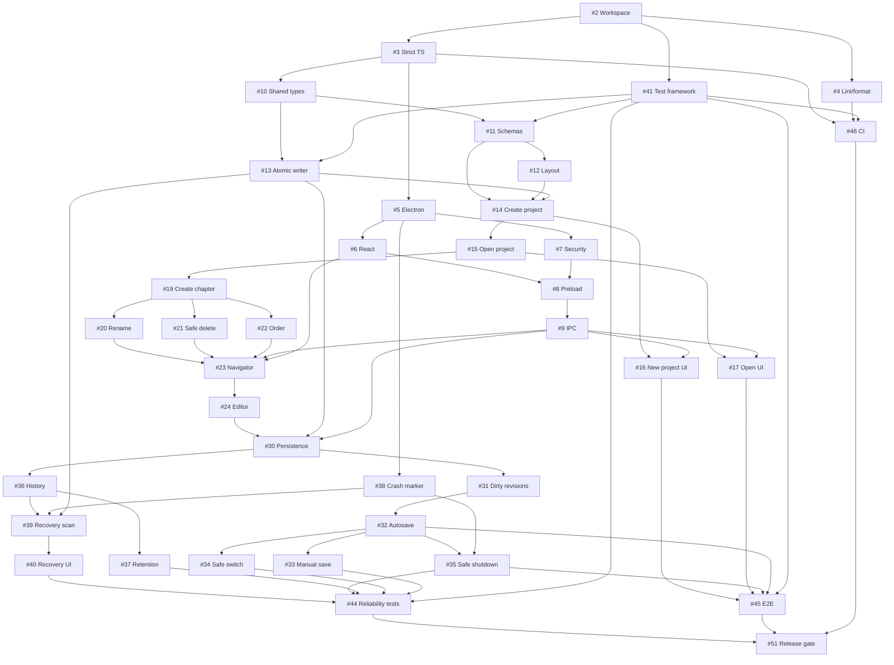

# GitHub tracking register

## Pre-release product identity

The product and workspace now use Drelwick. This owner-directed rename is CORE
(`product:core`) and supersedes the compatibility policy from completed
[#175](https://github.com/DarrenPratt/Drelwick/issues/175). It does not complete the
broader branding/distribution policy in #59 or any public-release gate.

The existing private repository is now `DarrenPratt/Drelwick`, and the existing
private project board is named `Drelwick`. Both were renamed in place on
24 September 2026, preserving repository history, issue numbers, milestones,
board identity and membership. Repository links and the local `origin` remote
use the new repository URL. No replacement domain, email or registry entry is
assumed to exist. Historical GitHub issue and PR discussions and Git history
remain unchanged.

## Original planning baseline

Reconciled 14 September 2026. Plan IDs remain stable source-document identifiers; GitHub numbers below are the actual created issues. All-state issue/title/marker searches preceded each creation. The initial repository had no issues or milestones, so none of the implementation issues was reused. This paragraph describes the initial planning snapshot, not the current implementation state. Consult live issues and the dated update below.

The original requirements from the two build plans are retained in each issue, supplemented with missing objective/scope/components/tests and product classification. Original prerequisites and additional readiness prerequisites are explicitly separated. The combined graph is acyclic.

Planning foundation: [#1](https://github.com/DarrenPratt/Drelwick/issues/1), completed by merged PR #63. Project board setup: [#62](https://github.com/DarrenPratt/Drelwick/issues/62). Projects access is now available through the account-authorized GitHub CLI; the original access blocker is resolved. The existing private Drelwick project (private board; link held in maintainer records) is linked to this repository and reused; no duplicate board was created.

## Local publishing update — 19 September 2026

The [local publishing plan](local-publishing-plan.md) maps new issue numbers and dependencies. Basic DOCX import moves to v0.2 and manuscript DOCX export to v0.3, both CORE. The application remains local; user-owned remote archive backup is separate exploration. The original task IDs and milestone names below remain unchanged.

At the start of this update, main was `37a7bb8`, with 44 closed and 19 open issues and no open PRs. Chapter editing, persistence and recovery were implemented; publishing was not. The readiness and Project initialization sections below are historical records, not a live board snapshot. New publishing issues are added as Backlog, not automatically Ready.

## Milestones

All eight were created; none existed to reuse.

- [v0.1 – Reliable Manuscript Editor](https://github.com/DarrenPratt/Drelwick/milestone/1)
- [v0.2 – Book Presentation & Preview](https://github.com/DarrenPratt/Drelwick/milestone/2)
- [Licensing & Commercial Architecture](https://github.com/DarrenPratt/Drelwick/milestone/3)
- [v0.3 – EPUB Publishing & Community Candidate](https://github.com/DarrenPratt/Drelwick/milestone/4)
- [v0.4 – Print Publishing](https://github.com/DarrenPratt/Drelwick/milestone/5)
- [v0.5 – Story Bible & Continuity](https://github.com/DarrenPratt/Drelwick/milestone/6)
- [v0.6 – Editing & Revision Tools](https://github.com/DarrenPratt/Drelwick/milestone/7)
- [v1.0 – Production Release](https://github.com/DarrenPratt/Drelwick/milestone/8)

Tasks 1–50 belong to v0.1; commercial tasks 51–58 and 60 belong to Licensing & Commercial Architecture; task 59 belongs to v0.3. The licensing milestone may run alongside v0.1/v0.2 but must finish before accepting external contributions. Task 60 remains future work; no Pro repository was created.

## Labels

Reused by renaming existing defaults: `bug` → `type:bug`, `documentation` → `type:documentation`, `enhancement` → `type:feature`.

Created 26 labels:

- `type:infrastructure`, `type:test`, `type:security`, `type:refactor`
- `area:electron`, `area:ui`, `area:editor`, `area:project`, `area:persistence`, `area:ipc`, `area:recovery`, `area:testing`, `area:build`, `area:architecture`, `area:licensing`, `area:github`
- `priority:critical`, `priority:high`, `priority:normal`, `priority:low`
- `product:core`, `product:pro`, `product:service`, `product:ecosystem`
- `commercial`, `legal-review` (preserved from the commercial plan; neither replaces product classification).

Seven unrelated defaults are retained: accessibility, duplicate, good first issue, help wanted, invalid, question, wontfix. No help-wanted/newcomer label is applied and no unrestricted external-contribution process is enabled.

## v0.1 backlog

All rows have `product:core`. An em dash means no dependency in that column. The release validation task depends on every preceding v0.1 plan task, excluding itself.

| Plan ID | Actual GitHub issue                                                                                                 | Original prerequisites                                                                                                                                                                                                                                                                                                                                                                                                                                                                                                                                                                             | Additional readiness prerequisites                                                                                 |
| ------- | ------------------------------------------------------------------------------------------------------------------- | -------------------------------------------------------------------------------------------------------------------------------------------------------------------------------------------------------------------------------------------------------------------------------------------------------------------------------------------------------------------------------------------------------------------------------------------------------------------------------------------------------------------------------------------------------------------------------------------------- | ------------------------------------------------------------------------------------------------------------------ |
| 1       | [Bootstrap pnpm TypeScript monorepo (#2)](https://github.com/DarrenPratt/Drelwick/issues/2)                         | —                                                                                                                                                                                                                                                                                                                                                                                                                                                                                                                                                                                                  | —                                                                                                                  |
| 2       | [Configure shared TypeScript strict settings (#3)](https://github.com/DarrenPratt/Drelwick/issues/3)                | [#2](https://github.com/DarrenPratt/Drelwick/issues/2)                                                                                                                                                                                                                                                                                                                                                                                                                                                                                                                                             | —                                                                                                                  |
| 3       | [Add repository linting and formatting (#4)](https://github.com/DarrenPratt/Drelwick/issues/4)                      | [#2](https://github.com/DarrenPratt/Drelwick/issues/2)                                                                                                                                                                                                                                                                                                                                                                                                                                                                                                                                             | —                                                                                                                  |
| 4       | [Create Electron desktop application shell (#5)](https://github.com/DarrenPratt/Drelwick/issues/5)                  | [#2](https://github.com/DarrenPratt/Drelwick/issues/2), [#3](https://github.com/DarrenPratt/Drelwick/issues/3)                                                                                                                                                                                                                                                                                                                                                                                                                                                                                     | —                                                                                                                  |
| 5       | [Add React renderer application (#6)](https://github.com/DarrenPratt/Drelwick/issues/6)                             | [#5](https://github.com/DarrenPratt/Drelwick/issues/5)                                                                                                                                                                                                                                                                                                                                                                                                                                                                                                                                             | —                                                                                                                  |
| 6       | [Apply Electron security baseline (#7)](https://github.com/DarrenPratt/Drelwick/issues/7)                           | [#5](https://github.com/DarrenPratt/Drelwick/issues/5)                                                                                                                                                                                                                                                                                                                                                                                                                                                                                                                                             | —                                                                                                                  |
| 7       | [Create typed Electron preload API (#8)](https://github.com/DarrenPratt/Drelwick/issues/8)                          | [#6](https://github.com/DarrenPratt/Drelwick/issues/6), [#7](https://github.com/DarrenPratt/Drelwick/issues/7)                                                                                                                                                                                                                                                                                                                                                                                                                                                                                     | —                                                                                                                  |
| 8       | [Add central typed IPC channel contracts (#9)](https://github.com/DarrenPratt/Drelwick/issues/9)                    | [#8](https://github.com/DarrenPratt/Drelwick/issues/8)                                                                                                                                                                                                                                                                                                                                                                                                                                                                                                                                             | —                                                                                                                  |
| 9       | [Create shared application type package (#10)](https://github.com/DarrenPratt/Drelwick/issues/10)                   | [#2](https://github.com/DarrenPratt/Drelwick/issues/2), [#3](https://github.com/DarrenPratt/Drelwick/issues/3)                                                                                                                                                                                                                                                                                                                                                                                                                                                                                     | —                                                                                                                  |
| 10      | [Define persistent project model schemas (#11)](https://github.com/DarrenPratt/Drelwick/issues/11)                  | [#10](https://github.com/DarrenPratt/Drelwick/issues/10)                                                                                                                                                                                                                                                                                                                                                                                                                                                                                                                                           | [#41](https://github.com/DarrenPratt/Drelwick/issues/41)                                                           |
| 11      | [Create standard project directory structure (#12)](https://github.com/DarrenPratt/Drelwick/issues/12)              | [#11](https://github.com/DarrenPratt/Drelwick/issues/11)                                                                                                                                                                                                                                                                                                                                                                                                                                                                                                                                           | —                                                                                                                  |
| 12      | [Add atomic project file persistence (#13)](https://github.com/DarrenPratt/Drelwick/issues/13)                      | [#10](https://github.com/DarrenPratt/Drelwick/issues/10)                                                                                                                                                                                                                                                                                                                                                                                                                                                                                                                                           | [#41](https://github.com/DarrenPratt/Drelwick/issues/41)                                                           |
| 13      | [Implement new project creation (#14)](https://github.com/DarrenPratt/Drelwick/issues/14)                           | [#11](https://github.com/DarrenPratt/Drelwick/issues/11), [#12](https://github.com/DarrenPratt/Drelwick/issues/12), [#13](https://github.com/DarrenPratt/Drelwick/issues/13)                                                                                                                                                                                                                                                                                                                                                                                                                       | —                                                                                                                  |
| 14      | [Implement existing project loading (#15)](https://github.com/DarrenPratt/Drelwick/issues/15)                       | [#11](https://github.com/DarrenPratt/Drelwick/issues/11), [#14](https://github.com/DarrenPratt/Drelwick/issues/14)                                                                                                                                                                                                                                                                                                                                                                                                                                                                                 | —                                                                                                                  |
| 15      | [Create new project dialog (#16)](https://github.com/DarrenPratt/Drelwick/issues/16)                                | [#8](https://github.com/DarrenPratt/Drelwick/issues/8), [#9](https://github.com/DarrenPratt/Drelwick/issues/9), [#14](https://github.com/DarrenPratt/Drelwick/issues/14)                                                                                                                                                                                                                                                                                                                                                                                                                           | —                                                                                                                  |
| 16      | [Add existing project open workflow (#17)](https://github.com/DarrenPratt/Drelwick/issues/17)                       | [#9](https://github.com/DarrenPratt/Drelwick/issues/9), [#15](https://github.com/DarrenPratt/Drelwick/issues/15)                                                                                                                                                                                                                                                                                                                                                                                                                                                                                   | —                                                                                                                  |
| 17      | [Add recent project tracking (#18)](https://github.com/DarrenPratt/Drelwick/issues/18)                              | [#15](https://github.com/DarrenPratt/Drelwick/issues/15), [#17](https://github.com/DarrenPratt/Drelwick/issues/17)                                                                                                                                                                                                                                                                                                                                                                                                                                                                                 | —                                                                                                                  |
| 18      | [Implement chapter creation (#19)](https://github.com/DarrenPratt/Drelwick/issues/19)                               | [#13](https://github.com/DarrenPratt/Drelwick/issues/13), [#14](https://github.com/DarrenPratt/Drelwick/issues/14), [#15](https://github.com/DarrenPratt/Drelwick/issues/15)                                                                                                                                                                                                                                                                                                                                                                                                                       | —                                                                                                                  |
| 19      | [Implement chapter rename operation (#20)](https://github.com/DarrenPratt/Drelwick/issues/20)                       | [#19](https://github.com/DarrenPratt/Drelwick/issues/19)                                                                                                                                                                                                                                                                                                                                                                                                                                                                                                                                           | —                                                                                                                  |
| 20      | [Implement safe chapter deletion (#21)](https://github.com/DarrenPratt/Drelwick/issues/21)                          | [#19](https://github.com/DarrenPratt/Drelwick/issues/19)                                                                                                                                                                                                                                                                                                                                                                                                                                                                                                                                           | —                                                                                                                  |
| 21      | [Implement manuscript chapter ordering (#22)](https://github.com/DarrenPratt/Drelwick/issues/22)                    | [#19](https://github.com/DarrenPratt/Drelwick/issues/19)                                                                                                                                                                                                                                                                                                                                                                                                                                                                                                                                           | —                                                                                                                  |
| 22      | [Create manuscript chapter navigator (#23)](https://github.com/DarrenPratt/Drelwick/issues/23)                      | [#19](https://github.com/DarrenPratt/Drelwick/issues/19), [#20](https://github.com/DarrenPratt/Drelwick/issues/20), [#21](https://github.com/DarrenPratt/Drelwick/issues/21), [#22](https://github.com/DarrenPratt/Drelwick/issues/22)                                                                                                                                                                                                                                                                                                                                                             | [#6](https://github.com/DarrenPratt/Drelwick/issues/6), [#9](https://github.com/DarrenPratt/Drelwick/issues/9)     |
| 23      | [Add TipTap manuscript editor (#24)](https://github.com/DarrenPratt/Drelwick/issues/24)                             | [#6](https://github.com/DarrenPratt/Drelwick/issues/6), [#23](https://github.com/DarrenPratt/Drelwick/issues/23)                                                                                                                                                                                                                                                                                                                                                                                                                                                                                   | —                                                                                                                  |
| 24      | [Add semantic scene break editor node (#25)](https://github.com/DarrenPratt/Drelwick/issues/25)                     | [#24](https://github.com/DarrenPratt/Drelwick/issues/24)                                                                                                                                                                                                                                                                                                                                                                                                                                                                                                                                           | —                                                                                                                  |
| 25      | [Add semantic block quote editing (#26)](https://github.com/DarrenPratt/Drelwick/issues/26)                         | [#24](https://github.com/DarrenPratt/Drelwick/issues/24)                                                                                                                                                                                                                                                                                                                                                                                                                                                                                                                                           | —                                                                                                                  |
| 26      | [Create restrained manuscript formatting toolbar (#27)](https://github.com/DarrenPratt/Drelwick/issues/27)          | [#24](https://github.com/DarrenPratt/Drelwick/issues/24), [#25](https://github.com/DarrenPratt/Drelwick/issues/25), [#26](https://github.com/DarrenPratt/Drelwick/issues/26)                                                                                                                                                                                                                                                                                                                                                                                                                       | —                                                                                                                  |
| 27      | [Add chapter and book word counts (#28)](https://github.com/DarrenPratt/Drelwick/issues/28)                         | [#24](https://github.com/DarrenPratt/Drelwick/issues/24)                                                                                                                                                                                                                                                                                                                                                                                                                                                                                                                                           | [#41](https://github.com/DarrenPratt/Drelwick/issues/41)                                                           |
| 28      | [Sanitize rich text pasted into manuscript editor (#29)](https://github.com/DarrenPratt/Drelwick/issues/29)         | [#24](https://github.com/DarrenPratt/Drelwick/issues/24)                                                                                                                                                                                                                                                                                                                                                                                                                                                                                                                                           | —                                                                                                                  |
| 29      | [Persist TipTap chapter documents (#30)](https://github.com/DarrenPratt/Drelwick/issues/30)                         | [#13](https://github.com/DarrenPratt/Drelwick/issues/13), [#19](https://github.com/DarrenPratt/Drelwick/issues/19), [#24](https://github.com/DarrenPratt/Drelwick/issues/24)                                                                                                                                                                                                                                                                                                                                                                                                                       | [#9](https://github.com/DarrenPratt/Drelwick/issues/9)                                                             |
| 30      | [Track unsaved manuscript changes (#31)](https://github.com/DarrenPratt/Drelwick/issues/31)                         | [#30](https://github.com/DarrenPratt/Drelwick/issues/30)                                                                                                                                                                                                                                                                                                                                                                                                                                                                                                                                           | —                                                                                                                  |
| 31      | [Add manuscript autosave (#32)](https://github.com/DarrenPratt/Drelwick/issues/32)                                  | [#30](https://github.com/DarrenPratt/Drelwick/issues/30), [#31](https://github.com/DarrenPratt/Drelwick/issues/31)                                                                                                                                                                                                                                                                                                                                                                                                                                                                                 | —                                                                                                                  |
| 32      | [Add manual Save command and keyboard shortcut (#33)](https://github.com/DarrenPratt/Drelwick/issues/33)            | [#32](https://github.com/DarrenPratt/Drelwick/issues/32)                                                                                                                                                                                                                                                                                                                                                                                                                                                                                                                                           | —                                                                                                                  |
| 33      | [Flush manuscript changes before chapter switch (#34)](https://github.com/DarrenPratt/Drelwick/issues/34)           | [#32](https://github.com/DarrenPratt/Drelwick/issues/32)                                                                                                                                                                                                                                                                                                                                                                                                                                                                                                                                           | —                                                                                                                  |
| 34      | [Flush pending manuscript changes on application shutdown (#35)](https://github.com/DarrenPratt/Drelwick/issues/35) | [#32](https://github.com/DarrenPratt/Drelwick/issues/32)                                                                                                                                                                                                                                                                                                                                                                                                                                                                                                                                           | [#38](https://github.com/DarrenPratt/Drelwick/issues/38)                                                           |
| 35      | [Create periodic chapter history snapshots (#36)](https://github.com/DarrenPratt/Drelwick/issues/36)                | [#30](https://github.com/DarrenPratt/Drelwick/issues/30)                                                                                                                                                                                                                                                                                                                                                                                                                                                                                                                                           | —                                                                                                                  |
| 36      | [Add manuscript history retention rules (#37)](https://github.com/DarrenPratt/Drelwick/issues/37)                   | [#36](https://github.com/DarrenPratt/Drelwick/issues/36)                                                                                                                                                                                                                                                                                                                                                                                                                                                                                                                                           | [#41](https://github.com/DarrenPratt/Drelwick/issues/41)                                                           |
| 37      | [Detect unclean application shutdown (#38)](https://github.com/DarrenPratt/Drelwick/issues/38)                      | [#5](https://github.com/DarrenPratt/Drelwick/issues/5)                                                                                                                                                                                                                                                                                                                                                                                                                                                                                                                                             | —                                                                                                                  |
| 38      | [Scan for manuscript recovery candidates after crash (#39)](https://github.com/DarrenPratt/Drelwick/issues/39)      | [#13](https://github.com/DarrenPratt/Drelwick/issues/13), [#36](https://github.com/DarrenPratt/Drelwick/issues/36), [#38](https://github.com/DarrenPratt/Drelwick/issues/38)                                                                                                                                                                                                                                                                                                                                                                                                                       | —                                                                                                                  |
| 39      | [Add manuscript recovery dialog (#40)](https://github.com/DarrenPratt/Drelwick/issues/40)                           | [#39](https://github.com/DarrenPratt/Drelwick/issues/39)                                                                                                                                                                                                                                                                                                                                                                                                                                                                                                                                           | —                                                                                                                  |
| 40      | [Configure repository unit testing (#41)](https://github.com/DarrenPratt/Drelwick/issues/41)                        | [#2](https://github.com/DarrenPratt/Drelwick/issues/2)                                                                                                                                                                                                                                                                                                                                                                                                                                                                                                                                             | —                                                                                                                  |
| 41      | [Add project schema and persistence unit tests (#42)](https://github.com/DarrenPratt/Drelwick/issues/42)            | [#11](https://github.com/DarrenPratt/Drelwick/issues/11), [#12](https://github.com/DarrenPratt/Drelwick/issues/12), [#13](https://github.com/DarrenPratt/Drelwick/issues/13), [#14](https://github.com/DarrenPratt/Drelwick/issues/14), [#15](https://github.com/DarrenPratt/Drelwick/issues/15), [#41](https://github.com/DarrenPratt/Drelwick/issues/41)                                                                                                                                                                                                                                         | [#22](https://github.com/DarrenPratt/Drelwick/issues/22)                                                           |
| 42      | [Test manuscript editor document schema (#43)](https://github.com/DarrenPratt/Drelwick/issues/43)                   | [#24](https://github.com/DarrenPratt/Drelwick/issues/24), [#25](https://github.com/DarrenPratt/Drelwick/issues/25), [#26](https://github.com/DarrenPratt/Drelwick/issues/26), [#41](https://github.com/DarrenPratt/Drelwick/issues/41)                                                                                                                                                                                                                                                                                                                                                             | —                                                                                                                  |
| 43      | [Test autosave and recovery behaviour (#44)](https://github.com/DarrenPratt/Drelwick/issues/44)                     | [#32](https://github.com/DarrenPratt/Drelwick/issues/32), [#33](https://github.com/DarrenPratt/Drelwick/issues/33), [#34](https://github.com/DarrenPratt/Drelwick/issues/34), [#35](https://github.com/DarrenPratt/Drelwick/issues/35), [#36](https://github.com/DarrenPratt/Drelwick/issues/36), [#37](https://github.com/DarrenPratt/Drelwick/issues/37), [#38](https://github.com/DarrenPratt/Drelwick/issues/38), [#39](https://github.com/DarrenPratt/Drelwick/issues/39), [#40](https://github.com/DarrenPratt/Drelwick/issues/40), [#41](https://github.com/DarrenPratt/Drelwick/issues/41) | —                                                                                                                  |
| 44      | [Add desktop end-to-end testing (#45)](https://github.com/DarrenPratt/Drelwick/issues/45)                           | [#16](https://github.com/DarrenPratt/Drelwick/issues/16), [#23](https://github.com/DarrenPratt/Drelwick/issues/23), [#24](https://github.com/DarrenPratt/Drelwick/issues/24), [#32](https://github.com/DarrenPratt/Drelwick/issues/32), [#41](https://github.com/DarrenPratt/Drelwick/issues/41)                                                                                                                                                                                                                                                                                                   | [#17](https://github.com/DarrenPratt/Drelwick/issues/17), [#35](https://github.com/DarrenPratt/Drelwick/issues/35) |
| 45      | [Add GitHub Actions continuous integration (#46)](https://github.com/DarrenPratt/Drelwick/issues/46)                | [#3](https://github.com/DarrenPratt/Drelwick/issues/3), [#4](https://github.com/DarrenPratt/Drelwick/issues/4), [#41](https://github.com/DarrenPratt/Drelwick/issues/41)                                                                                                                                                                                                                                                                                                                                                                                                                           | —                                                                                                                  |
| 46      | [Create standard manuscript test fixtures (#47)](https://github.com/DarrenPratt/Drelwick/issues/47)                 | [#11](https://github.com/DarrenPratt/Drelwick/issues/11)                                                                                                                                                                                                                                                                                                                                                                                                                                                                                                                                           | —                                                                                                                  |
| 47      | [Implement structured application logging (#48)](https://github.com/DarrenPratt/Drelwick/issues/48)                 | [#5](https://github.com/DarrenPratt/Drelwick/issues/5)                                                                                                                                                                                                                                                                                                                                                                                                                                                                                                                                             | —                                                                                                                  |
| 48      | [Add renderer and main process error boundaries (#49)](https://github.com/DarrenPratt/Drelwick/issues/49)           | [#6](https://github.com/DarrenPratt/Drelwick/issues/6), [#48](https://github.com/DarrenPratt/Drelwick/issues/48)                                                                                                                                                                                                                                                                                                                                                                                                                                                                                   | —                                                                                                                  |
| 49      | [Create native application menus and shortcuts (#50)](https://github.com/DarrenPratt/Drelwick/issues/50)            | [#8](https://github.com/DarrenPratt/Drelwick/issues/8), [#16](https://github.com/DarrenPratt/Drelwick/issues/16), [#17](https://github.com/DarrenPratt/Drelwick/issues/17), [#33](https://github.com/DarrenPratt/Drelwick/issues/33)                                                                                                                                                                                                                                                                                                                                                               | —                                                                                                                  |
| 50      | [Prepare v0.1 release validation checklist (#51)](https://github.com/DarrenPratt/Drelwick/issues/51)                | All plan tasks 1–49 ([#2](https://github.com/DarrenPratt/Drelwick/issues/2)–[#50](https://github.com/DarrenPratt/Drelwick/issues/50))                                                                                                                                                                                                                                                                                                                                                                                                                                                              | —                                                                                                                  |

## Commercial architecture backlog

Tasks 51–59 are CORE governance/interfaces/release preparation. Task 60 is PRO. All legal-review decisions remain open. Task 55 classification setup was completed by merged PR #63; actual issue #56 is closed.

| Plan ID | Actual GitHub issue                                                                                                        | Original prerequisites                                                                                                                                                                                                                                                                                                                                                                                                                                                         | Additional readiness prerequisites                                                                                 |
| ------- | -------------------------------------------------------------------------------------------------------------------------- | ------------------------------------------------------------------------------------------------------------------------------------------------------------------------------------------------------------------------------------------------------------------------------------------------------------------------------------------------------------------------------------------------------------------------------------------------------------------------------ | ------------------------------------------------------------------------------------------------------------------ |
| 51      | [Define Drelwick Community and Pro feature boundary (#52)](https://github.com/DarrenPratt/Drelwick/issues/52)              | —                                                                                                                                                                                                                                                                                                                                                                                                                                                                              | —                                                                                                                  |
| 52      | [Review and select Drelwick Community licence (#53)](https://github.com/DarrenPratt/Drelwick/issues/53)                    | —                                                                                                                                                                                                                                                                                                                                                                                                                                                                              | —                                                                                                                  |
| 53      | [Define contributor agreement and copyright strategy (#54)](https://github.com/DarrenPratt/Drelwick/issues/54)             | —                                                                                                                                                                                                                                                                                                                                                                                                                                                                              | [#53](https://github.com/DarrenPratt/Drelwick/issues/53)                                                           |
| 54      | [Establish architectural boundary between Community and Pro (#55)](https://github.com/DarrenPratt/Drelwick/issues/55)      | —                                                                                                                                                                                                                                                                                                                                                                                                                                                                              | [#52](https://github.com/DarrenPratt/Drelwick/issues/52)                                                           |
| 55      | [Add CORE PRO SERVICE ECOSYSTEM feature classification (#56)](https://github.com/DarrenPratt/Drelwick/issues/56)           | —                                                                                                                                                                                                                                                                                                                                                                                                                                                                              | —                                                                                                                  |
| 56      | [Design Community extension API for Pro and plugins (#57)](https://github.com/DarrenPratt/Drelwick/issues/57)              | [#55](https://github.com/DarrenPratt/Drelwick/issues/55)                                                                                                                                                                                                                                                                                                                                                                                                                       | —                                                                                                                  |
| 57      | [Create public Drelwick project format specification (#58)](https://github.com/DarrenPratt/Drelwick/issues/58)             | —                                                                                                                                                                                                                                                                                                                                                                                                                                                                              | [#11](https://github.com/DarrenPratt/Drelwick/issues/11), [#12](https://github.com/DarrenPratt/Drelwick/issues/12) |
| 58      | [Define Drelwick branding and official distribution policy (#59)](https://github.com/DarrenPratt/Drelwick/issues/59)       | —                                                                                                                                                                                                                                                                                                                                                                                                                                                                              | —                                                                                                                  |
| 59      | [Prepare Drelwick Community for public release (#60)](https://github.com/DarrenPratt/Drelwick/issues/60)                   | [#52](https://github.com/DarrenPratt/Drelwick/issues/52), [#53](https://github.com/DarrenPratt/Drelwick/issues/53), [#54](https://github.com/DarrenPratt/Drelwick/issues/54), [#55](https://github.com/DarrenPratt/Drelwick/issues/55), [#56](https://github.com/DarrenPratt/Drelwick/issues/56), [#57](https://github.com/DarrenPratt/Drelwick/issues/57), [#58](https://github.com/DarrenPratt/Drelwick/issues/58), [#59](https://github.com/DarrenPratt/Drelwick/issues/59) | —                                                                                                                  |
| 60      | [Create private Drelwick Pro repository and integration skeleton (#61)](https://github.com/DarrenPratt/Drelwick/issues/61) | [#55](https://github.com/DarrenPratt/Drelwick/issues/55)                                                                                                                                                                                                                                                                                                                                                                                                                       | [#57](https://github.com/DarrenPratt/Drelwick/issues/57)                                                           |

## v0.1 critical dependency paths

This is a dependency path, not a duration estimate. Every v0.1 task remains required for the release gate; branches below show the main convergence points.

## Readiness and unresolved decisions

- Begin [#2](https://github.com/DarrenPratt/Drelwick/issues/2) (pnpm bootstrap) after the planning foundation PR is reviewed. Deliver [#41](https://github.com/DarrenPratt/Drelwick/issues/41) early, then [#3](https://github.com/DarrenPratt/Drelwick/issues/3)/[#4](https://github.com/DarrenPratt/Drelwick/issues/4) and CI [#46](https://github.com/DarrenPratt/Drelwick/issues/46) as prerequisites permit.
- Resolve the chapter-summary/cache design in [#15](https://github.com/DarrenPratt/Drelwick/issues/15). Confirm cross-platform atomic replacement/durability and multi-file failure ordering in [#13](https://github.com/DarrenPratt/Drelwick/issues/13)/[#19](https://github.com/DarrenPratt/Drelwick/issues/19)/[#21](https://github.com/DarrenPratt/Drelwick/issues/21).
- Define session marker location/concurrency in [#38](https://github.com/DarrenPratt/Drelwick/issues/38); handle stale acknowledgements in [#31](https://github.com/DarrenPratt/Drelwick/issues/31) and recovery candidate timestamp ties in [#39](https://github.com/DarrenPratt/Drelwick/issues/39).
- Packaging tool, runtime/tool versions and full three-platform packaging verification remain implementation decisions; document platform limitations in [#51](https://github.com/DarrenPratt/Drelwick/issues/51). CI/protection is pending [#46](https://github.com/DarrenPratt/Drelwick/issues/46), so this planning PR cannot claim application CI passed.
- Community feature granularity, licence, contribution/dual-licensing strategy, extension security/versioning and trademark decisions remain tracked in [#52](https://github.com/DarrenPratt/Drelwick/issues/52)–[#59](https://github.com/DarrenPratt/Drelwick/issues/59). Public release requires [#60](https://github.com/DarrenPratt/Drelwick/issues/60) and the [release checklist](public-release-checklist.md).
- Project board access is resolved and setup is tracked in [#62](https://github.com/DarrenPratt/Drelwick/issues/62). Repository and Project visibility remain private; no Pro checkout is needed.

## Project board setup

The owner-created Drelwick (private board; link held in maintainer records) is the build plan's development board. Its existing name and repository link are retained. The initial inspection after authorization found one private Project, already linked to Drelwick, with no items and the default Todo/In Progress/Done statuses.

Configured fields:

| Field     | Values / source                                                                                            |
| --------- | ---------------------------------------------------------------------------------------------------------- |
| Status    | Backlog, Ready, In Progress, Review, Blocked, Done                                                         |
| Priority  | Critical, High, Normal, Low; initialized from issue priority labels                                        |
| Area      | electron, ui, editor, project, persistence, ipc, recovery, testing, build, architecture, licensing, github |
| Milestone | Existing native field; follows the issue milestone rather than a duplicate custom field                    |
| Estimate  | XS, S, M, L, XL; left unset until assessed                                                                 |
| Labels    | Existing native field retains every type, area, priority and product classification                        |

All 62 existing issues (#1?#62) are included exactly once. Closed foundation/classification issues #1 and #56 are Done. Bootstrap #2 is Ready following the planning PR merge. Board setup #62 is Review pending its documentation PR. Other open issues are Backlog. Area holds one representative area initialized from the issue's sorted area labels; the Labels field retains all applicable areas.

Validation re-read the private Project, repository link, item membership and field options. A reversible status change on #62 (Review -> In Progress -> Review) confirmed field updates work. No issue was closed or reopened for that test.

Automatic status transitions, dependency readiness and ongoing label-to-field synchronization are **not assumed**. Maintain Status, Priority and primary Area explicitly during triage; update status after PR review/merge and assess dependencies before marking Ready. Native labels/milestones follow their issues. Project workflow automation can be adopted after its actual behaviour is verified; this setup does not depend on it.
