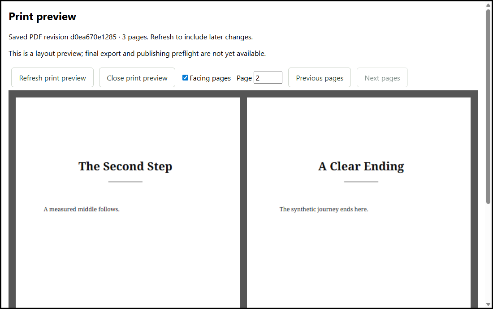

# Local print pagination and PDF preview

Issue #129 is CORE. Open **Book preview → Print preview** to render the saved
book. Pending edits must save first. Page navigation covers the entire book;
facing mode places physical verso on the left and recto on the right, with a
display-only empty slot before page one. Refresh captures a new saved revision.
A failed save/render retains the previous PDF and manuscript. The displayed
revision is a snapshot: later changes require an explicit refresh.

## One PDF production pipeline

`assembleBook(path, { print: true })` captures the existing `print.json` settings
under the same project lock as semantic documents, publication order, theme and
validated asset bytes. Settings are checked again before releasing the lock,
including absent-to-present changes. Ebook assembly never reads print settings.
There are no persistent format changes or manuscript writes.

`renderPrintRevision` in the desktop main process consumes that captured value.
It uses the existing semantic renderer's print inclusion rules, inert links,
embedded captured images, Community themes and shared page geometry. The
revision includes book content identity, all print settings, selected theme,
font hashes, pipeline version and Chromium version.

The Electron adapter prints each chapter/matter section with bundled Chromium's
`printToPDF`, using native CSS fragmentation. PDF-lib copies these exact pages,
inserts intentional recto separators and adds embedded-font running matter.
The returned PDF bytes are the production result, not an HTML approximation.
PDF.js draws those bytes in the preview. #130 uses this exact result for [local PDF export and preflight](print-export.md)
without duplicating layout or re-rendering; final validation remains pending.

This refines the original single-HTML/Playwright proposal: Electron already
ships Chromium on every target, while Playwright remains the test driver.
Section PDFs allow reliable chapter headers and separate Roman/decimal counting
without relying on unsupported CSS running-string/counter behaviour. There is
no downloaded browser, secondary browser installation, or preview-only layout.

## Supported pagination and typography

- Each included matter item/chapter starts a fresh page. Body chapters obey
  next-page or recto starts. Mirrored geometry includes the gutter exactly once.
  Section printing swaps left/right CSS margins when its first physical page is
  verso; displayed folios never decide physical side.
- Front matter counts lowercase Roman folios (optionally hidden); body starts
  at the configured decimal number and continues through back matter. Blank
  separators count in the preceding section and show neither headers nor folios.
- Header sources, outside positioning, footer position and chapter-opening
  visibility consume the existing settings. An overwide or multiline header is reported and
  omitted rather than silently shrunk or cropped. Diagnostics prevent any claim
  that the preview is publication-ready.
- Paragraphs, list items and quotations request two widows and two orphans.
  Headings and scene breaks request keep-with-next; headings, images and epigraphs
  request no internal break. These are Chromium fragmentation constraints, not
  an advanced paragraph compositor. Oversized unbreakable content may force a
  break and is diagnosed. Empty authored paragraphs remain present.
- Hyphenation is manual: author-supplied soft hyphens can break; no OS dictionary
  or automatic dictionary download is used. Long unbreakable words are reported
  as overflow rather than changed in the manuscript.
- Print substitutes licensed bundled Noto Serif for Classic/Literary font tokens
  and Noto Sans for Modern. All other theme sizes, spacing and ornaments are
  reused. All four normal/italic 400/700 faces must load before measurement and
  printing; font synthesis and system substitution are disabled. Chromium embeds
  content fonts; PDF-lib subsets the running-matter font.
- This first font set supports its Latin glyph inventory, including accented
  prose and typographic punctuation. Text outside that inventory (for example
  CJK) blocks preview explicitly. Fontkit checks every emitted text character
  against the bundled faces before Chromium can silently substitute fonts.
  Broader script coverage needs additional licensed resources and validation;
  it is not a Pro/account restriction. Ebook/editor font behaviour is unchanged.

See [resource licences](attributions/print/README.md). Exact output is scoped to
the renderer/font version; OS-wide or future-Chromium pixel identity is not claimed.

## Diagnostics and isolation

DOM measurements detect horizontal overflow, oversized headings/images/epigraphs,
and clipped scroll boxes. Independent PDF text bounds detect text outside the
content box. PDF text/image operators detect unexpected blank output before
running matter is added; intentional inserted blanks are separately recorded.
Missing/invalid semantic assets, failed image decode and unresolved fonts stop
the render. Layout diagnostics accompany the PDF and identify section/page.
These are measurable checks, not exhaustive collision detection, accessibility
validation, bleed/DPI analysis or publisher preflight.

Each render uses a hidden sandboxed BrowserWindow with context isolation, no
Node integration, no preload, no filesystem grant, denied permissions/downloads,
denied navigation/popups and a fresh nonpersistent cache-disabled session.
Its request interceptor permits only generated data URLs/about:blank and rejects
network and file requests. A restrictive CSP independently blocks active content
and connections; only hashed trusted styles and embedded image/font data load.
The IPC accepts only a project UUID, validates the trusted top-level frame and
active project, and resolves the path in main. Failures return fixed messages;
manuscript text and underlying errors are never logged or forwarded.

Print capture is limited to 64 MiB with a 30-second cooperative filesystem budget.
Rendering has a 120-second deadline and each section load/print a 15-second
deadline. Input markup, cumulative section PDF bytes and final PDF are limited to
64 MiB, with 1,000 sections and 2,000 pages maximum. Limits fail explicitly; they
never truncate the book. Synchronous bounded font/PDF work yields at asynchronous
boundaries; this is not an OS-level memory quota or interruptible filesystem I/O.
Timeouts destroy the render window, and all success/failure paths destroy it in
`finally`. PDF inspection tasks/workers are destroyed, preview workers/render tasks
are released on replacement/close, and only visible pages are rasterized. No job
creates temporary HTML/PDF files, a browser profile directory or a child browser
process. Electron owns its ordinary renderer-process lifecycle.

## Acceptance evidence and remaining work

Dependencies #128/#121 are implemented by merged PRs #212/#189, verified against
schemas, locked settings/book reads, shared semantic rendering, themes and IPC.

| #129 criterion                                          | Evidence                                                                                                                                                                             |
| ------------------------------------------------------- | ------------------------------------------------------------------------------------------------------------------------------------------------------------------------------------ |
| Chapters/matter, recto, mirrored layout, headers/folios | Multi-page Chromium fixture, independent PDF text/positions, physical page metadata and golden                                                                                       |
| Widow/orphan, keep-with-next, hyphenation, fonts        | Explicit policy tests; real split-paragraph minimum-line checks; heading/paragraph co-location; soft-hyphen fixture; embedded-font inspection; missing glyph/load failures           |
| PDF-backed full book/facing preview and same revision   | Real desktop offline canvas/navigation/refresh failure test; repeated production renders compared by all PDF text positions; preview consumes the production bytes                   |
| Overflow, clipping, blank pages, assets/fonts           | DOM/PDF measurements; oversized heading/word fixtures; unexpected blank unit test; missing/corrupt images, unsupported glyphs and invalid font data                                  |
| Isolation, network denial, bounds, cleanup              | Local HTTP server receives zero requests; unauthorized IPC tests; overall/stalled-print deadlines; hidden-window count returns to baseline; bounded input/output and finally cleanup |

The checked-in text/geometry golden and native execution evidence are Windows
only. The behavioural tests can run on other targets; #131 owns platform/output
release validation. The PDF preview has been visually inspected using its actual
facing-page canvas output. #130 final export and preflight now have a working-tree
implementation with [validation pending](print-export.md). #133 advanced publishing,
broader font coverage and packaged three-platform validation remain separate. No Pro, service or cloud work
is introduced.

Validation on Windows with Node 24.18.0, pnpm 10.34.5 and Electron 39.1.2:
frozen-lockfile installation, lint, formatting, typecheck, build and Community
workspace checks pass. All 992 unit/integration tests and all 20 desktop
end-to-end tests pass. Coverage passes (71.85% statements, 73.96% lines across
the repository; native Electron behaviour is additionally tested by Playwright).
Windows unpacked-package inspection and the packaged offline PDF-preview scenario
also pass, including font/worker/native-library presence checks. Packaging uses
the documented `npm exec --package=pnpm@10.34.5 -- pnpm` fallback: this host's
standalone `pnpm.exe` cannot be passed as JavaScript to the existing packaging
wrapper. This validation does not establish macOS/Linux packaged print support.
