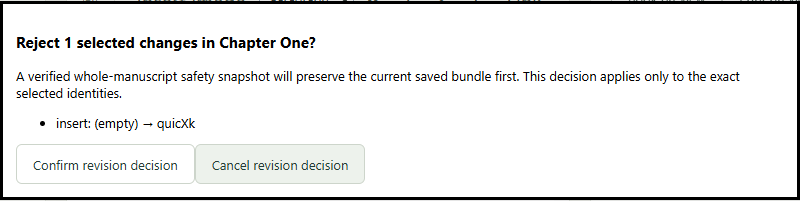

# Local revision tracking and review

Revision review is CORE functionality. It runs offline with local project files;
there is no account, cloud collaboration or AI editing involved. Existing projects
must first use the explicit editorial-format upgrade in Comments & annotations.

## Track changes in a chapter

Use **Track changes in this chapter** above the manuscript. Its saved indicator
shows whether tracking is on and how many changes are pending. Turning it off
leaves pending changes pending. The editor shows proposed text, underlines pending
insertions/formatting and labels removed text. Expand **Review pending changes**
to read original and proposed slices, local author labels when present, and exact
semantic formatting/structure. Labels are local display information, not verified
account identities.

Typing at the current insertion endpoint forms one short typing unit. IME updates
with the same composition identity stay in one unit. Paste, selection replacement,
formatting and other independent commands start distinct actions. Unicode is
preserved without normalization; patches expand to complete grapheme boundaries.
Supported semantics include marks, headings, lists, quotes, epigraphs, links,
images, hard breaks and scene breaks.

An edit touching a pending unit opens **Combine affected changes**. Inspect the
affected identities and before/after text and formatting, then explicitly combine,
review first, or cancel. Combining creates a new identity and retains superseded
evidence in transaction before images. Cancelling leaves the previous text and
groups intact. This also applies when tracking is off: disjoint ordinary edits
update accepted and proposed text together; collisions require explicit tracking
and combination, review first, or cancellation.

Replace All uses the same policy in one scoped atomic transaction. It requires
chapter review first if an intersecting replacement preview exceeds the
native dialog's 16,000-character bound. No partial replacement is applied.
Split/merge and text-only Chapter History restore require pending changes to be reviewed
first. Duplicating a chapter with pending changes asks whether to copy accepted
or proposed text; the original review state and private discussions stay with the
original chapter. Deletion retains the complete chapter through existing recovery.

## Decide and comment

Each change has **Review accept change** and **Review reject change**. Chapter-wide
buttons name the chapter scope and exact number of changes. Both individual and
bulk actions show a confirmation before writing. A verified whole-manuscript
**before-review** safety snapshot is mandatory. A stale preview fails as a whole;
refresh it rather than attempting a partial decision.

**Comment on original text** selects a deletion/replacement's retained original
slice in Comments & annotations. Enter and save the comment there. It has a retained
target, not an invented position in the live manuscript. Rejecting the change can
restore that target through its recorded inverse. Accepting retains the discussion
and original evidence without publishing it. **Use live manuscript selection**
returns the comment form to ordinary selection. Existing discussions follow actual
ProseMirror maps; no similarity search guesses an attachment.

Normal Undo/Redo includes review, tracking and annotation companions in the current
editor session. Saving undo advances persistent counters. Reopening does not invent
an undo stack; use named snapshots or recovery across sessions. Annotation drafts
and manuscript drafts participate in the existing dirty-state/navigation controls.

## Preview and publish

When any saved chapter has pending changes, each new preview/output operation asks:

- **Accepted text only**: keep original formatting/deletions and omit insertions.
- **Proposed text including pending changes**: include all pending changes.
- **Cancel**: create no output.

This choice never accepts or rejects revisions. It is bound to the captured source
generation and exact bytes, and is not remembered as a default for later outputs.
PDF export asks again and must match its reviewed print preview; select a different
state by refreshing the preview first. Changed source requires a new capture/choice.

DOCX, EPUB and PDF contain only selected semantic manuscript/publication content.
Private comments, local labels, revision IDs, patch records and unselected retained
slices are excluded. DOCX import rejects unresolved Word tracked changes and
comments explicitly. Resolve/remove these in a separate copy before importing;
the original file is preserved.

## Storage, recovery and limits

Chapter-v2 `content` remains accepted text. Review-v1 stores normalized, ordered,
disjoint patches plus a validated proposed document. Their exact slices and hashes
must reproduce that document. Unsupported versions or inconsistent data block
editing rather than silently selecting a copy. Older editorial implementations
reject tracking/pending records; do not downgrade these projects.

The implementation reuses the #170 transaction/draft directories and #171 named
snapshot format. Accept/reject and bulk replacement preserve safety snapshots;
snapshot capture/restore and portable backup retain pending groups, both text
states, discussions and required assets. No second journal or undo authority is
introduced. Retained images and drafts are not silently pruned.

Pre-commit failures preserve or recover the complete before generation. After the
commit marker, recovery verifies the complete after generation. If a response is
lost, **Retry original decision** uses the same operation identity and captured
request. Unexpected external bytes or missing recovery images block automatic
recovery without overwriting them. Keystrokes never staged durably cannot be
promised recovered. Filesystem/device power-loss guarantees remain platform-specific.

Existing semantic/document and editorial limits apply: bounded file reads, at most
1,000 pending groups per chapter, 8 MiB captured save payloads, eight live review
tokens, and bounded session companion retention. Replace All additionally bounds each chapter to
1,000 matches and 32 MiB of source-by-match normalization work. Narrow the query or
chapter scope when this limit is reached. Oversized/unsupported changes
are refused with drafts retained. No manuscript text is logged by review IPC.

See [format details](editorial-format.md), [workflow design](editing-revisions.md),
and [implementation/test evidence](planning/173-implementation-status.md).
