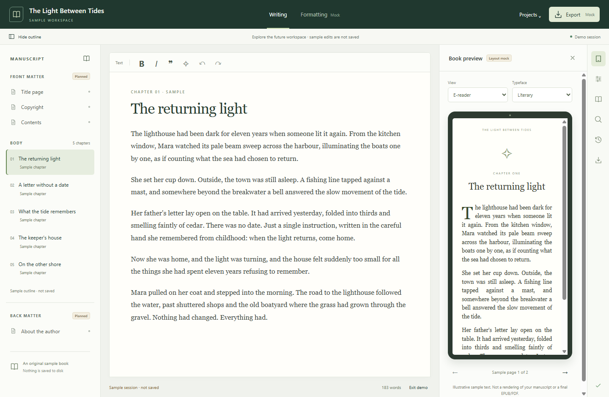

# Authoring workspace demonstration

Choose **Explore workspace** on the welcome screen to try the sample authoring layout. The outline, sample prose, preview, temporary theme controls and sample navigation are interactive. Changes stay in memory for that visit. Exiting returns to the project launcher; it does not write a project, save setting or export file.

The project workspace uses the same header, book outline, writing surface and tool sidebar. The current chapter editor, save state, autosave, project operations, retained history and crash-recovery flow remain connected to their existing local services.

## Layout preview

This screenshot shows the sample workspace. Front and back matter, theme selection, publication details, preview rendering, DOCX/EPUB/PDF export, manuscript search and a browsable history view have illustrative or marked unavailable states until their implementation issues are delivered.

The device and theme selectors demonstrate future layout directions. This page uses original sample prose; it does not render the author's project. It does not create a valid publishing preview or certify EPUB/PDF output. The local tools remain useful without an account or network connection.

Related delivery issue: [#141](https://github.com/DarrenPratt/BookEditor/issues/141).
